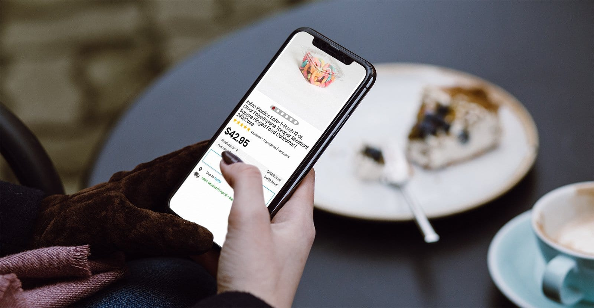
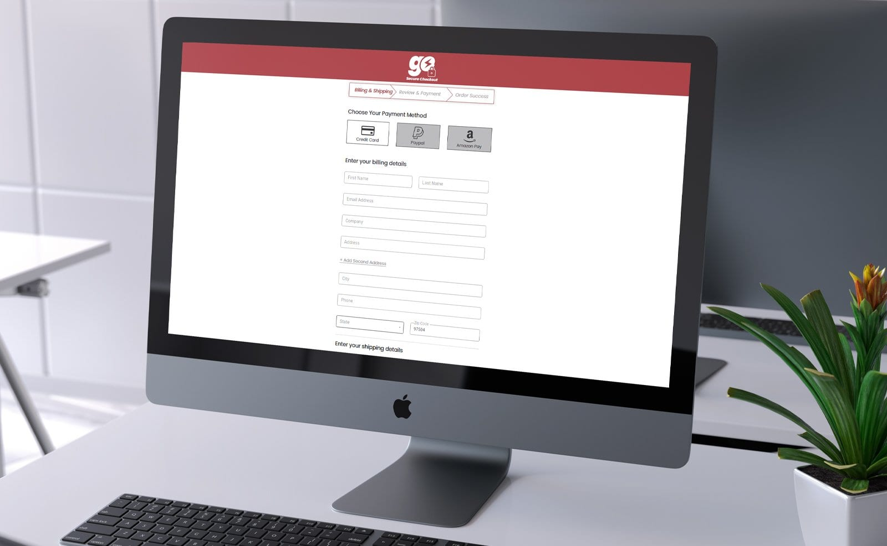
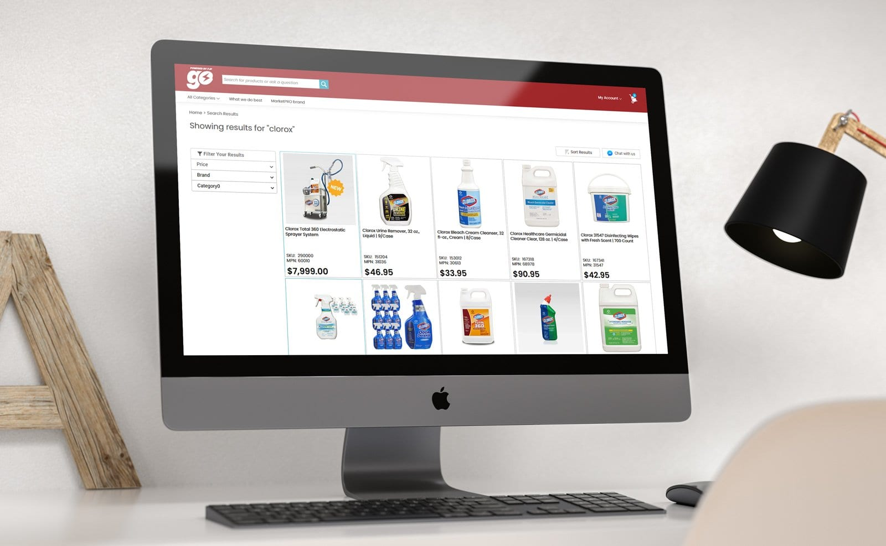
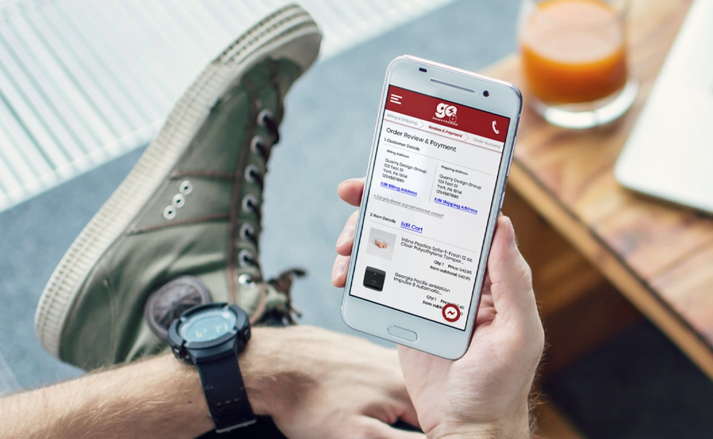
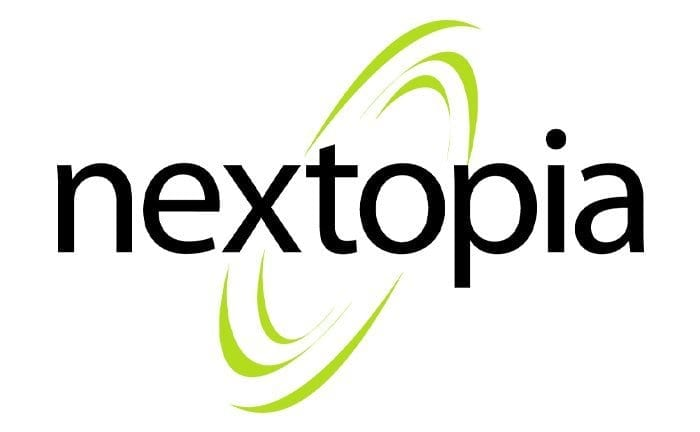
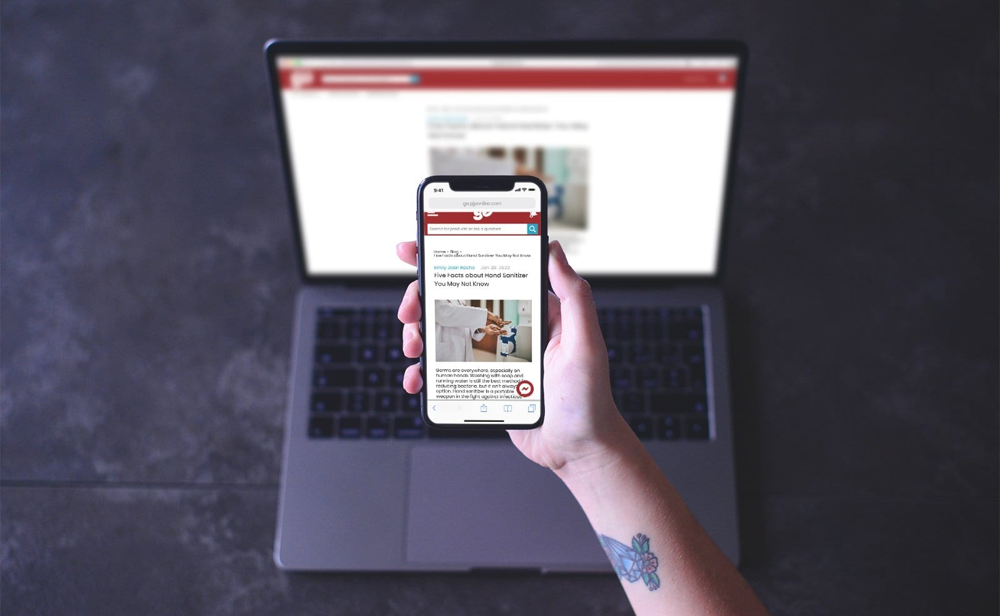
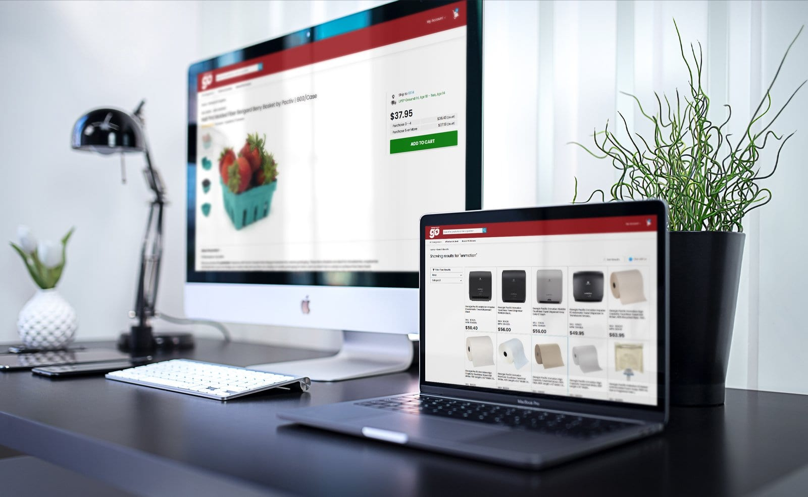

In December of 2018, Penn Jersey Paper Co. reached out to us about migrating their Magento 1 shopping cart to Magento 2. Quarry was thrilled to take on the project as Magento is a mainstay in the wheelhouse, and we were happy to be working with our friends at PJP again.

## Deciding on PWA

While the migration would be occurring, the PJP team was also curious about the new “PWA Studio” project that had just been announced by Magento in late November that year.

After performing discovery research on the PWA Studio project and learning that the project was based on a React frontend with a headless connection to Magento using GraphQL, our interest was piqued. We love React around here and the stack sounded very promising.

## Breaking ground

At the time that we began this project, the Magento PWA Studio package was merely in an exploratory, proof-of-concept phase under active community development. The package included foundational GraphQL endpoints for Magento, an “UPWARD” Express.js server which included a frontend router and a service worker for PWA, as well as a small package of barebones frontend React components. Documentation for all of this was rich, which made our lives much easier, but the overall amount of engineering required to reach a fully functional shopping cart for PJP was steep.

Before writing a single line of code, our first step was to thoroughly digest the documentation that the Magento team had available for the PWA project.

## Design

The UIX design for the project was handled internally by the PJP team, with marginal support provided by our design team along the way. The PJP team did a terrific job with the design paying very specific attention to the mobile UIX in favor of the PWA experience.

    

## Development

With designs in-hand, we set off on development. We selected the material-ui React library for the frontend UI, as it was a nice match for the designs that the PJP team had created.

During the development process, we needed to integrate several vendor tools that were part of the PJP ecommerce stack. The first of those was Nextopia, which provided site-search and a product recommendations engine. Nextopia had a solid API with decent documentation available which made this process fairly smooth. However, it just so happened that they were transitioning from a legacy version of the API to an updated version as we were integrating. This created a few bumps in the road, but with the help of some technical contacts at Nextopia, we were able to work through it.

The next vendor integration was Yotpo, which also had a full API available which made integrating the Yotpo data into React components a breeze.

Lastly, PayPal Payflow Pro for both credit card and PayPal transactions, and Amazon Payments had to be integrated. For both of these, we needed to write new GraphQL APIs that connected to the existing core Magento backend endpoints which then handled communication with the respective transaction processor APIs.

Amazon Payments gave us a few issues which required some assistance from a technical contact at Amazon. We found that the core Magento Amazon Pay module would not accept the Order and Agreement IDs that we were passing to it from the React frontend. After some troubleshooting from the Amazon Pay team, we were able to get these issues resolved and complete the integration.

Finally, not exactly a vendor integration, but the PJP team requested for their corporate blog to be syndicated on the shopping cart site. Since the corporate blog was on WordPress, this was a straightforward process using the WordPress REST API. Whenever a new post is published on the corporate WordPress site, it automatically appears on PJP Go site.

## The finished product

All said and done, the product turned out better than we even expected. React used for a shopping cart results in a buttery-smooth user experience on desktop and mobile devices alike.

Javascript framework shopping carts are no-doubt the way of the future, much like Javascript frameworks are the future of all other varieties of digital products.

## The PWA benefits

The decision to go with PWA resulted in several incredibly valuable features for both the PJP organization and its users.

1.  **Native install**
    One of the more significant features of the PWA spec is installation on native iOS and Android devices, (and even desktop!) just like a conventional native app from the App or Play Stores. This gives the PJP shopping cart a valuable home on their customer’s mobile devices; always just a tap away. Further, when installed, the service worker pre-caches many of the app’s more significant screens onto the device, which makes navigation even faster than on web; creating a very authentic native app user experience.
2.  **Push notifications**
    Once a PWA has been installed on a native (or desktop) device, native push notifications can be sent. This is a very high-value new channel opportunity for customer life-cycle marketing and promotional campaigns with many opportunities for automation. Push notifications can be automatically delivered for abandoned carts, reorder reminders, product recommendations, etc and then manually sent for anything else. Such as promotional campaigns, announcements, sales, and more.
3.  **A single codebase for web and native**
    PWA effectively eliminates the need to build and maintain a native app, allowing for a single, unified web and native codebase. This saves the PJP organization thousands of dollars a year in development costs to maintain a native app, as well as the initial investment to build one. Plus, Google has announced that they will soon be allowing PWAs to be listed in the Google Play Store, further—if not entirely—eliminating the need for traditional native apps.

## Results

PJP rebranded the storefront as Quipply during development, and it launched in July 2021 as [quipply.com](https://quipply.com/), a headless Magento 2 and React PWA.

> At the risk of sounding cheesy, the only thing easier than actually working with the team at Quarry is recommending them to one of my peers. I approached them with a monster of a project – I wanted to push a restaurant supply distributor ahead of the competition with a high-performance, Ecommerce web app built on React. Without hesitation, they accepted the challenge with genuine excitement.
>
> From the beginning, we established an understanding that this build would be breaking new ground for everyone involved. Conceptually, we understood PWA but never actually built one – let alone one complex enough to accommodate the modern habits of both B2C and B2B buyers.
>
> We worked closely with Quarry to design every aspect of the user interface and user experience from the ground up. There were no templates! So, their knowledge and experience were invaluable. They were extremely supportive and sensitive to changes in scope and budget. After all, neither of us really knew what to expect and something like that can be difficult to navigate.
>
> In the end, the relationship is what made this project a success. Everyone had the chops to execute but communication and trust was key. Quarry is a team that I would trust implicitly for projects of any size.
>
> — David Black, eCommerce Manager, PJP
