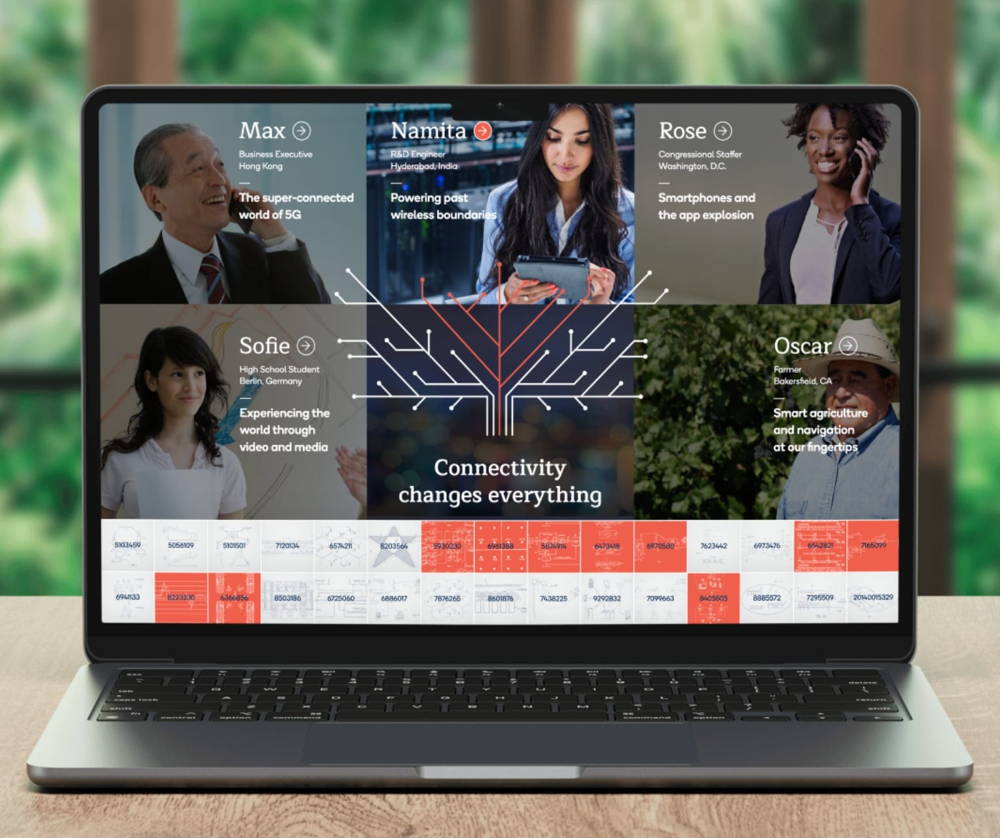
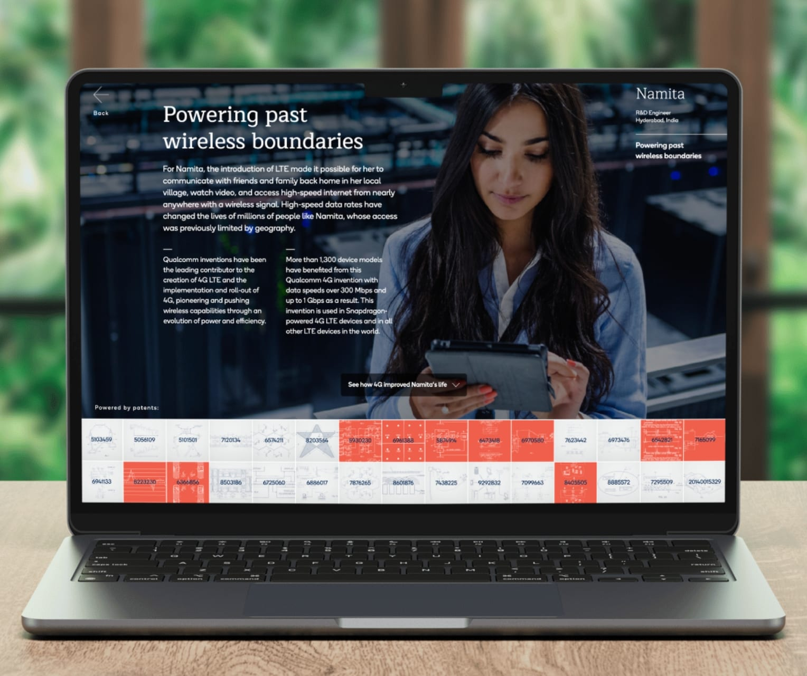
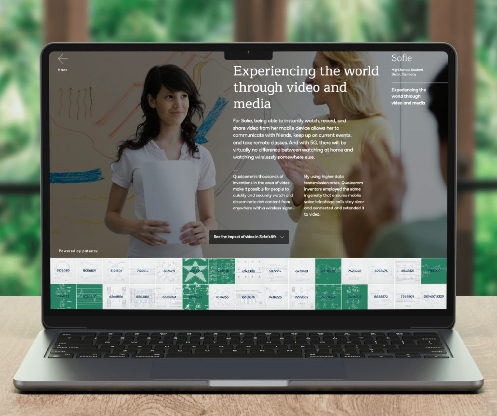
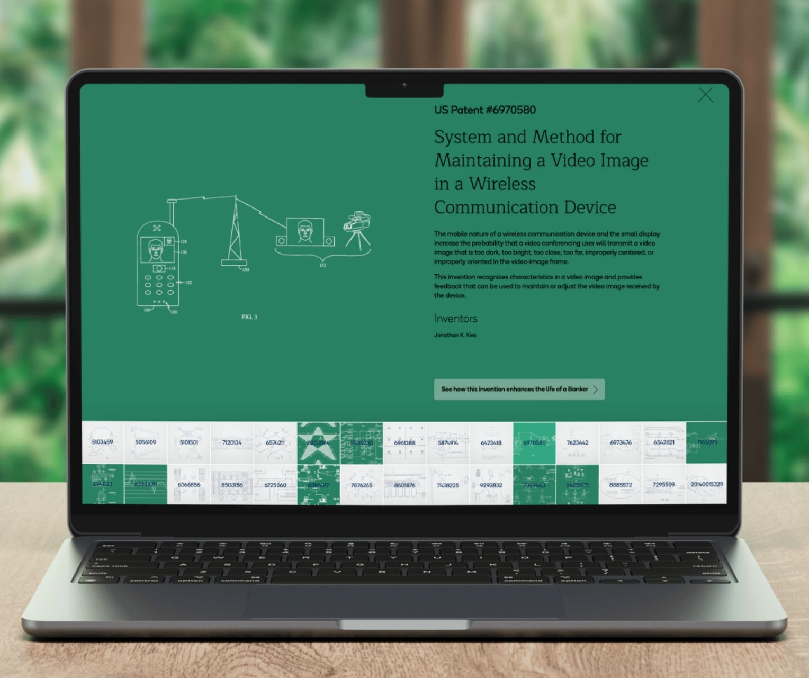

While we often build web products, apps, and websites at Quarry – our digital expertise extends beyond the virtual realm into tangible, real-world applications.

Our work with the [National Inventors Hall of Fame](https://www.invent.org/) and [Qualcomm](https://www.qualcomm.com/) showcases our ability to inherit complex projects and elevate them to new heights of reliability and performance.

## The Challenge

The project presented us with two existing touchscreen applications that needed to be maintained and optimized for continuous operation in a museum setting.

One [showcasing Qualcomm’s wireless technology patents](http://wirelessfamilytree.com), and a separate application highlighting female inventors, both required our expertise to ensure they would perform flawlessly in a high-visibility environment.

The stakes were high, as any downtime could significantly impact the visitor experience as well as the museum and Qualcomm’s reputation.

Quarry needed to implement a robust monitoring system that would allow us to track performance remotely and address any issues promptly.

## The Solution

Quarry revised the existing single-page applications, focusing on optimizing performance and user experience.

We revamped the UX of [WirelessFamilyTree.com](https://wirelessfamilytree.com/) – an engaging, narrative-driven journey. This interactive experience showcases Qualcomm’s innovations, their real-world applications, and the impact of their patents on diverse individuals.

   

The applications are built on Gatsby, with WordPress serving as the content management system. This architecture creates a flexible, efficient system that allows for seamless content updates while maintaining a smooth, responsive user interface.

Part of the inheritance required migrating the cloud infrastructure from the previous development team’s cloud to Qualcomm’s AWS account. While at it, we bolstered the infrastructure and implemented a real-time monitoring system that observed the availability of the applications on the actual touchscreens in the exhibit of the museum. These allowed us to track visitor access to the applications in the exhibit in real time, enabling swift resolution by pinging the NIHF IT team if any issues occurred.

## The Results

We achieved and validated 100% uptime for both touchscreen applications and the technology seamlessly integrated into the museum environment, enhancing the educational experience without calling attention to itself. Precisely what is needed for a public-facing installation.

_Disclaimer: We love efficiency and we also believe in transparency. LLMs (Large Language Models) were used to structure the outline to save time while writing this piece._
