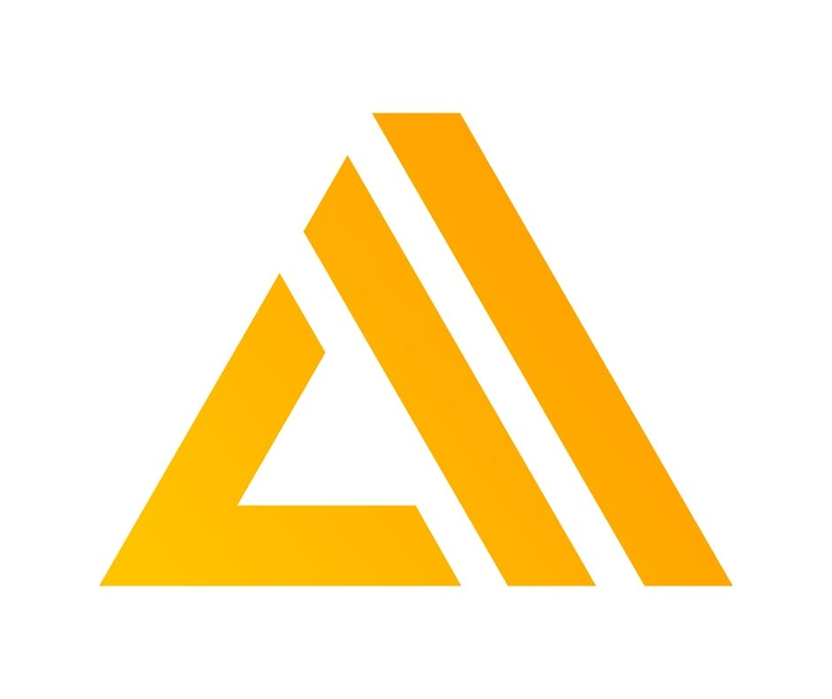
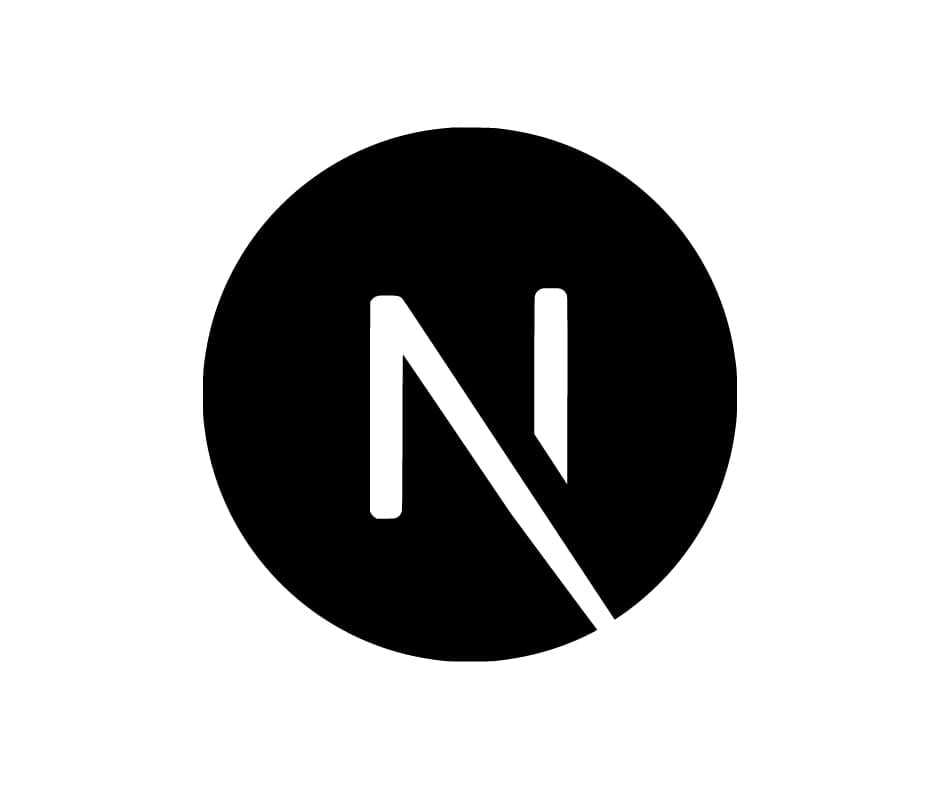
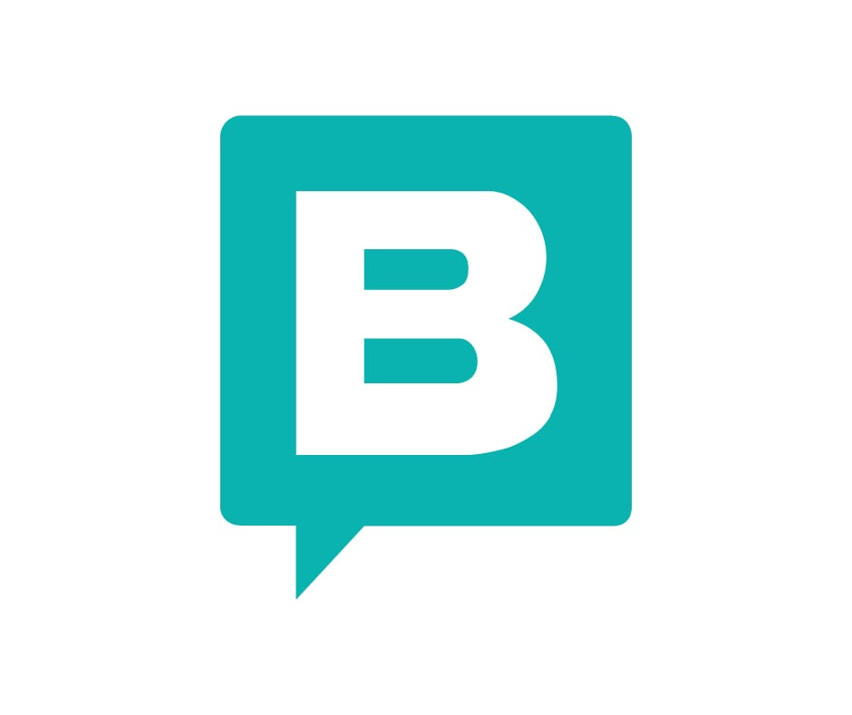
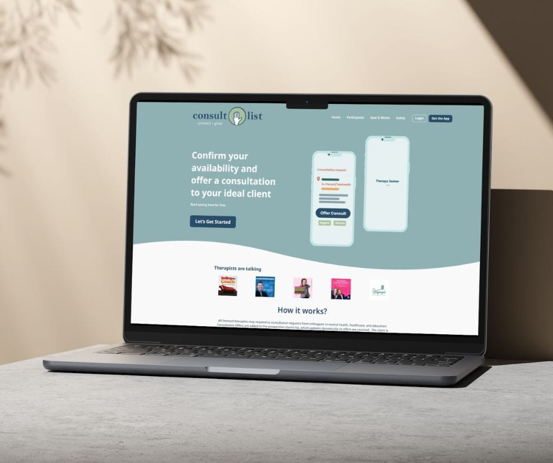
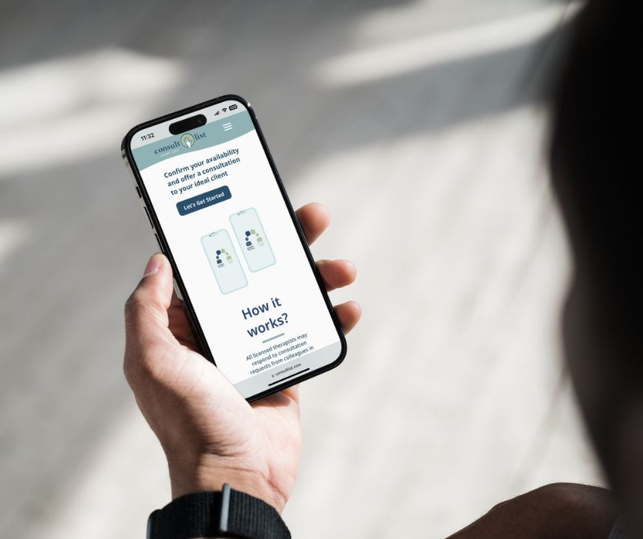

## How next-gen tech revolutionized a startup’s marketing website, pairing user-friendly design with advanced technology for effortless updates and maintenance.

## The Challenge

- Create a marketing site that could be managed, updated, and maintained by non-technical team members
- Client interested in experimenting with new and novel technologies

Consult List is a lean startup serving therapists through professional consultation referrals.
They had previously developed their Minimum Viable Product (MVP) independently using Bubble.

In this project, the requirement was to revamp the marketing site for Consult List, with a focus on creating a user-friendly platform.

There was also an interesting, atypical requirement – the founders wanted a site that they could easily manage, maintain, and update independently for both simple content changes and also for more complex design overhauls.

The project was made more compelling by the client’s openness to experiment with innovative, cutting-edge technologies. The client was also eager to design the layout and look of the site, and used Figma, a user-friendly design tool they were comfortable with.

  

## The Solution

- A hybrid headless marketing site utilizing [Next.js](https://nextjs.org/), [Storyblok](https://www.storyblok.com/), and [AWS Amplify Studio Figma to React](https://docs.amplify.aws/javascript/build-ui/uibuilder/)

With the design finalized by the client, the elegance of this project lies in its architecture.

The core of the completed site is a headless Next.js application paired with Storyblok for content management in several areas – again, easy to update and maintain without outside assistance.

The informational pages of the site are straightforward Storyblok implementations, allowing for easy creation, deletion, or editing of pages. These pages utilize Next.js’ incremental static regeneration, checking Storyblok for content updates every 30 minutes. This ensures that the site remains current with new, updated, or deleted content while being as fast and performant as possible via static generation.

For design, Quarry utilized AWS’s Amplify Studio’s Figma to React feature, a relatively bleeding-edge product. This technology allows Figma designs to be converted into React components through an almost no-code interface within Amplify Studio, making it highly accessible for the client.

And, in certain sections, Quarry blended both backends – images and design come from Figma to React, while the written content, such as testimonials in a slider, is sourced from Storyblok.

 

## The Results

- Achieved a marketing site that can be maintained and quickly iterated on by Consult List with zero regular ongoing support from engineering

Quarry set up the system and then handed over the production site to Consult List. They now have the capability to modify and update their site’s design whenever they wish, using the AWS Amplify Studio Figma to React pipeline.

Utilizing Storyblok, Next.js and Figma to React, Quarry was able to deliver exactly what the client wanted – an essentially no-code solution that could be updated easily by any member of the Consult List team.
