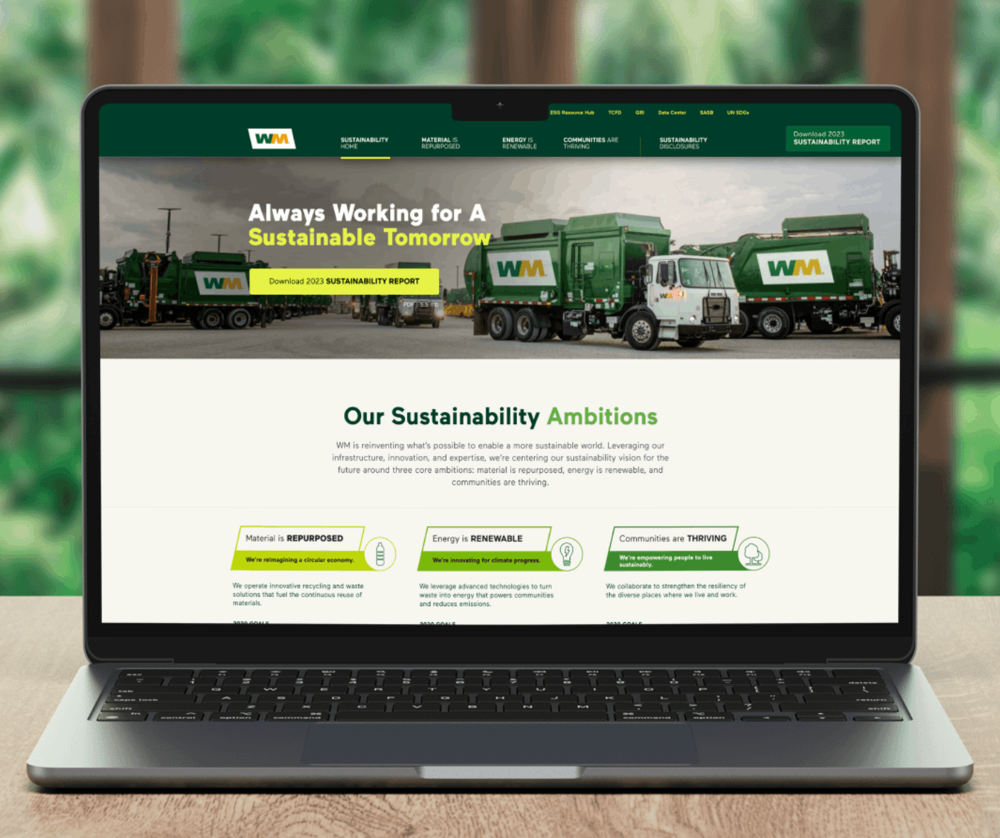
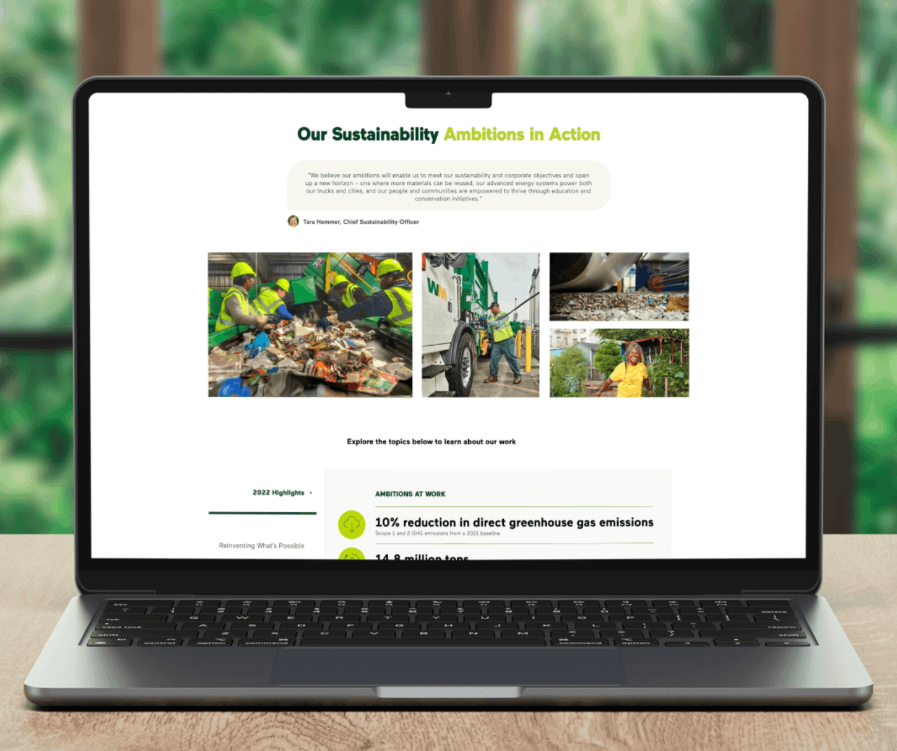
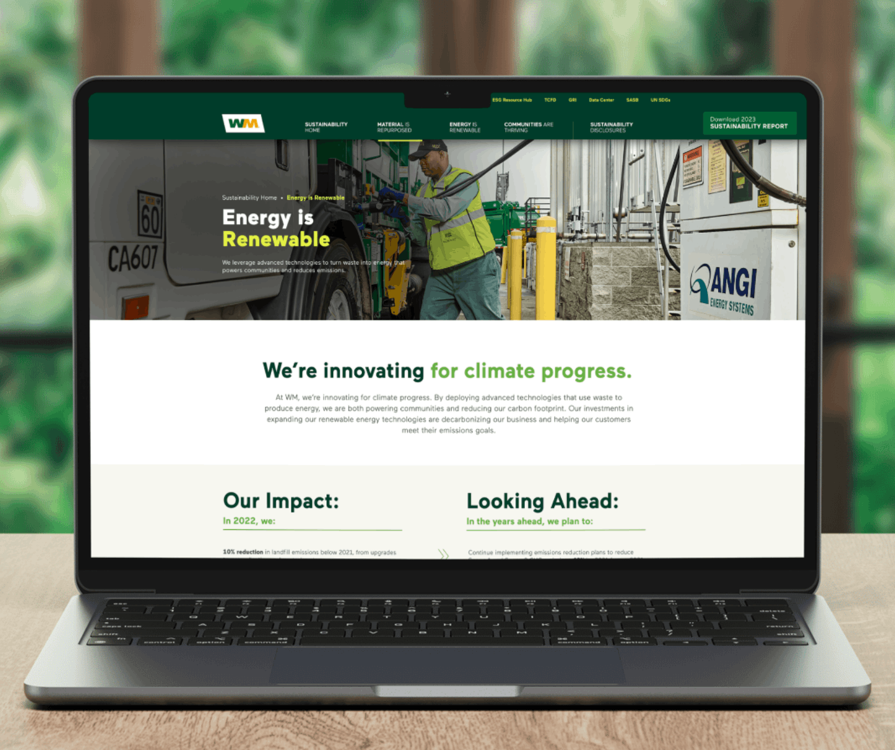
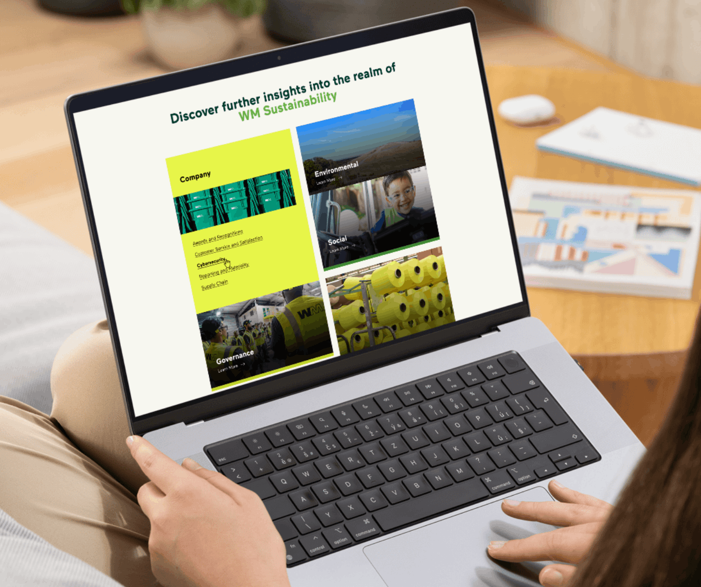
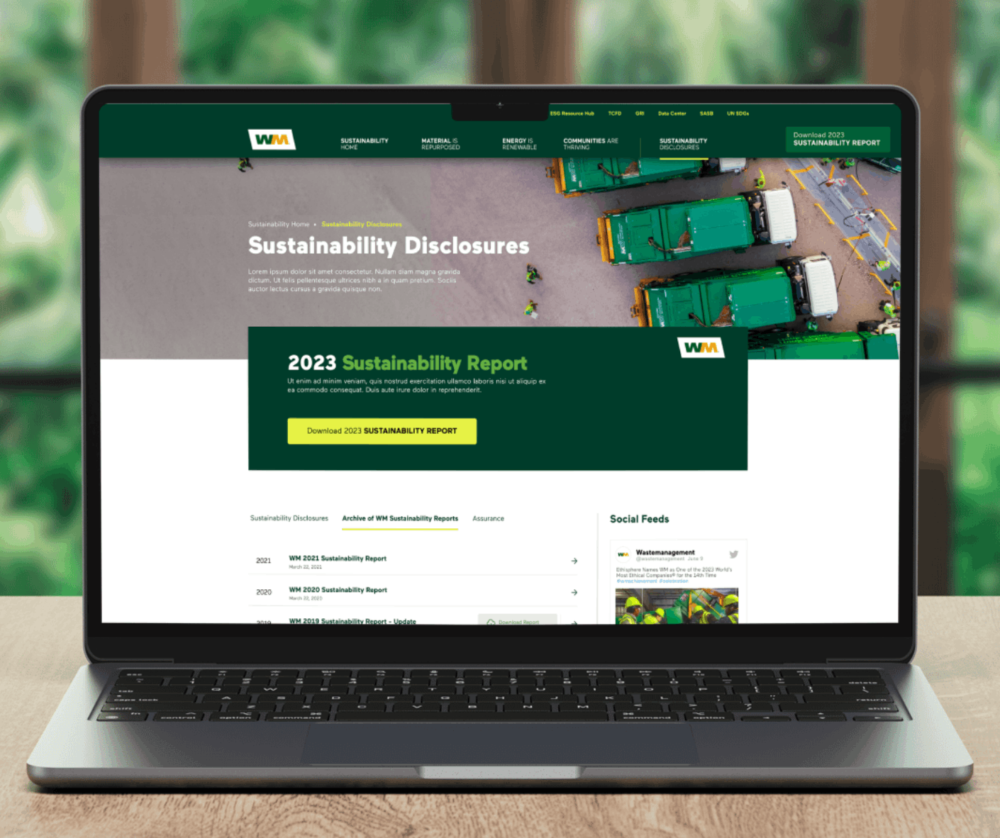

## The Challenge

WM’s sustainability team initiated a microsite redesign project to coincide with their anniversary milestone in 2023. The initial scope was set as a redesign of sustainability.wm.com developed on Next.js to create a more modern, performant experience.

Midway through development, a new requirement emerged: legacy pages needed to maintain their existing URLs on the same subdomain. These legacy pages were on CorePHP but contained critical historical content referenced across WM’s digital properties and the project budget could not support a change order to migrate these pages to the Next.js project. The technical challenge involved maintaining both systems on a single domain while working within the original timeline and budget constraints.

## The Solution

Quarry developed an innovative dual-stack architecture that would serve both old and new content seamlessly to visitors.

The solution centered on some creative nginx config that routed requests between the legacy CorePHP and the new Next.js framework depending on the requested path. When visitors accessed the site, they would experience a smooth, consistent journey whether they were viewing fresh content or archived materials.

Implementation involved:

- Nginx server configuration to handle URL-based routing between systems
- Next.js application deployment in WM’s AWS environment
- CI/CD pipeline implementation for automated deployments
- DNS configuration changes coordinated with WM’s technology team to cutover when the next-gen site was ready to ship
- Documentation for WM’s team on managing both systems

    

## The Results

The project launched on schedule for WM’s anniversary milestone. The new system successfully maintained all legacy URLs while delivering the redesigned site, requiring no additional budget despite the expanded scope. The sustainability team received a modern, high-performance website that preserved their historical content without disruption to existing links or resources.
