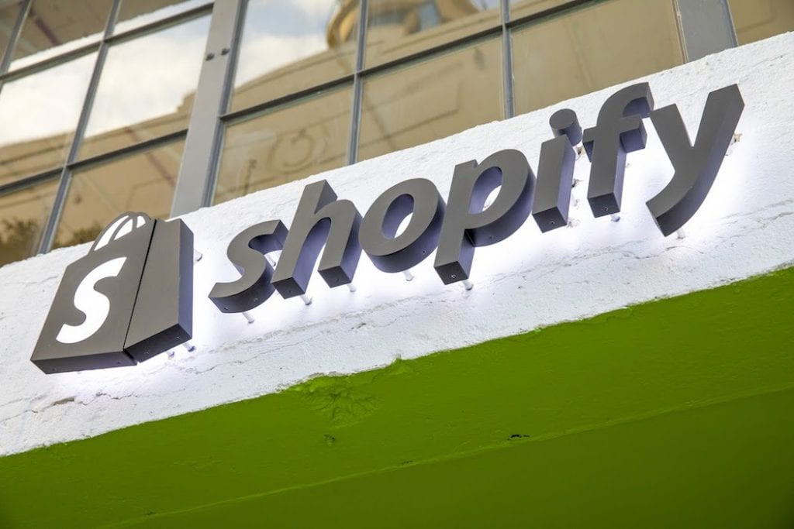
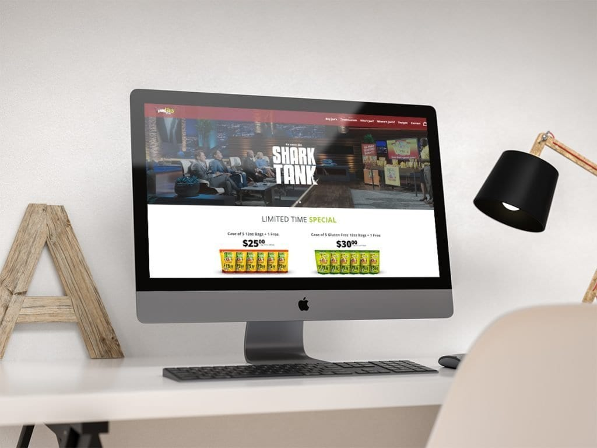
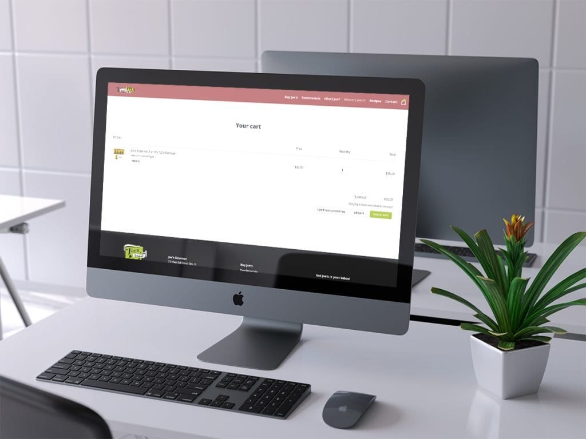
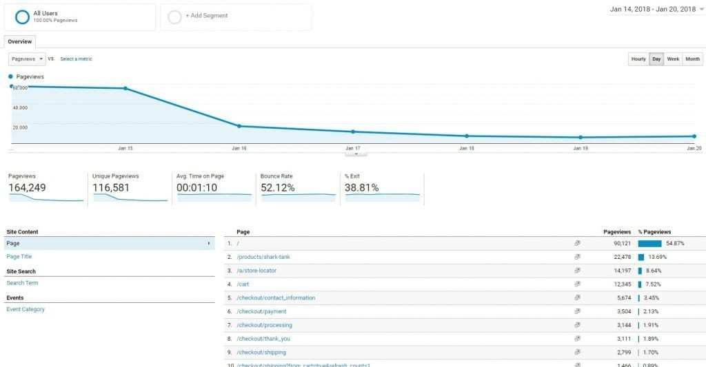
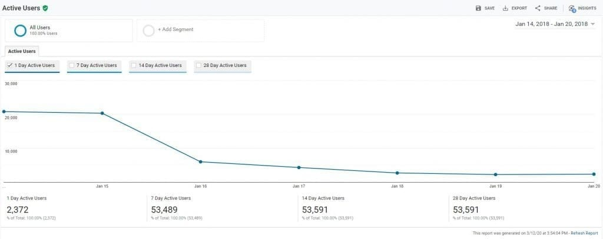
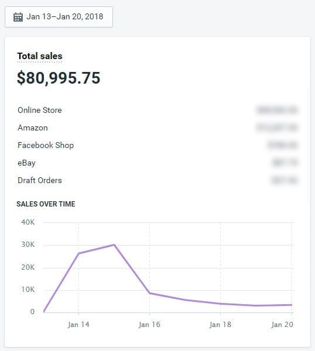
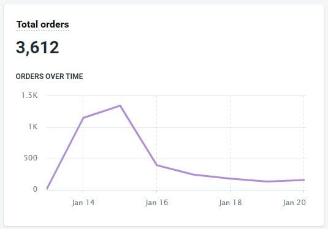
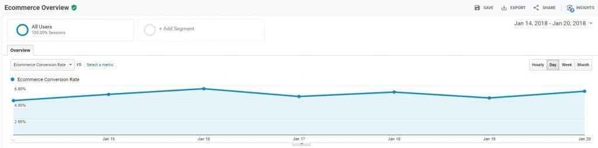

In December of 2017, Quarry was approached by the wonderful folks at Joe’s Gourmet with the need of launching an ecommerce shopping cart prior to their national television debut on the ABC series _Shark Tank_ in mid-January 2018.

## The brief

The Joe’s Gourmet folks reached out to us after discovering our work for Shark Wheel, a Shark Tank alumni brand. (So many Sharks) They had a tight deadline with a very clear run-list of requirements and were in need of a technology partner who could deliver on all of their needs on-time and within their budget.

The first requirement on the list was a fast delivery of the shopping cart. The Shark Tank airing was an infallible deadline that had to be met.

Next, was a rock-solid backend infrastructure. With the upcoming Shark Tank airing, the Joe’s Gourmet team had realistic expectations for the amount of traffic that their website would be receiving and any amount of downtime during this time would lead to significant lost sales. Knowing this, they recognized that their backend needed to be capable of withstanding dramatic traffic spikes.

Lastly, being a DTC consumable startup with modest funding, the budget for the build was realistic but not unlimited, and overages needed to be avoided.

After receiving the list of needs and defining the scope, we were confident in our ability to deliver and excited to take on the high-stakes challenge of the project.

## The shopping cart strategy

When it came time to decide the stack for the shopping cart, the primary concern was stability, knowing the surge in traffic that the Shark Tank airing would create.

At the time of the shopping cart build, prior to the airing, Joe’s Gourmet had already been picked up by shark Daymond John. Being a Shopify investor, Daymond and his team were encouraging Joe’s to choose Shopify as their shopping cart platform.

Knowing the upcoming traffic demands that the shopping cart would need to endure, Shopify’s turn-key cloud infrastructure was an ideal match, so we did not disagree there.

Shopify’s cloud architecture and edge network would easily be able to withstand the traffic spikes with no interruption to frontend user experience. This would be accomplished at a fraction of the cost of a different shopping cart platform hosted at another cloud provider with auto-scaling enabled. This is not to mention the significant DevOps overhead investment to put that auto-scaling architecture in place on another conventional cloud provider.

## The crunch

The project was officially kicked-off on December 22nd, 2017, with a launch deadline of January 13th, 2018, for a total of 15 working days.

Thankfully, knowing the time constraints, the Joe’s Gourmet team only wanted a very concise MVP scope for the initial launch. A homepage, a product page with two variants, the cart, and the Shopify default checkout.

At the time of the Shopify build, the organization already had a rudimentary info website running WordPress. With time so limited, Joe’s chose not to invest in design for the MVP Shark Tank launch, instead opting to just port the UI of the basic WordPress site over to Shopify.

The header, footer, and homepage of the WordPress site UI were ported to Shopify.

For the remainder of the Shopify templates, we relied on the Shopify “Debut” theme, which is rooted in ecommerce design best-practices.

## The launch

On the date of the Shark Tank episode airing, the traffic surge was as large as expected. The site received over 41,000 page views in the hour that the episode aired, over 110,000 page views in the first two days, and nearly 170,000 page views for the week.

Thanks to the Shopify cloud network, the site experienced zero downtime during the crucial Shark Tank premiere. All of Joe’s Gourmet’s potential customers driven to the site by the episode were able to smoothly browse the site and check out quickly, unencumbered by the tens of thousands of other Shark Tank viewers browsing the site at the very same moment.

## The results

During the hour of the Shark Tank episode, gross sales were nearly $13,000, over $20,000 for the day of the episode, $45,000 in the first two days, and more than $80,000 in the first week.

Conversion rate for the entire first week was at or above 4.5%.

When it came to fulfill these thousands of orders, Shopify’s robust order export features made batch fulfillment a breeze for the Joe’s Gourmet team with the help of their UPS partners.

The Joe’s Gourmet team was thrilled with the success and ease of their Shopify launch. From what we understand, we even got a nod from Daymond John that we “killed it.” Thanks, Daymond!

> Quarry is professional and great to work with. The quality of work is excellent and always delivered on time.
>
> — Maranda Walker-Dowell, Director of Operations, Joe’s Gourmet
