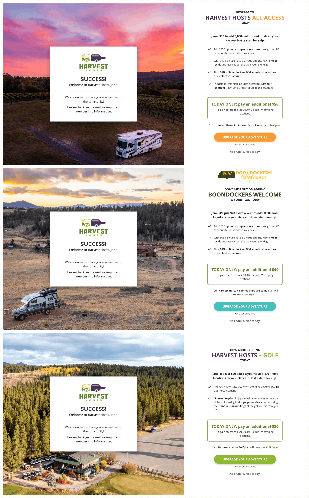
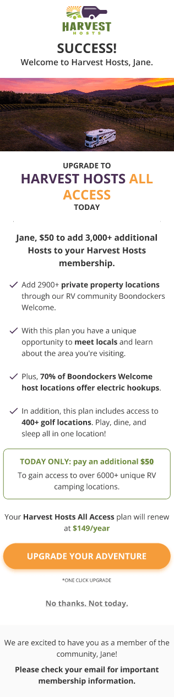

## The Challenge

[Harvest Hosts](https://harvesthosts.com/) had built a highly successful flagship product with a strong, high-converting sales funnel for their Classic membership.

As their product portfolio expanded through acquisitions to include Boondockers Welcome and Golf Courses, they saw an opportunity to increase revenue through strategic upsells. However, they faced a critical question: Would introducing upgrade options during sign-up risk disrupting their already successful conversion process?

The question: how much revenue could an upsell add before it started costing sign-ups? They needed to understand if it was too early in the customer relationship to present upgrades, and how different offer placements might impact overall conversion rates.

## The Solution

Quarry designed a testing strategy to optimize both timing and presentation of upgrade offers.

We created an interstitial screen that appeared immediately after users completed their initial Classic membership purchase but before entering the dashboard. This placement ensured we weren’t interrupting the primary purchase decision while still capturing users at a moment of high engagement.

We also focused on minimizing friction. Using Chargebee, we designed and then developed a one-click upgrade system that seamlessly processed the additional charge without requiring users to re-enter payment information. We then tested multiple variants, including:

- A tiered approach starting with an All Access upgrade offer (including Classic, Boondockers Welcome, and Golf Courses).
- A mid-tier upgrade adding Boondockers Welcome to the Classic membership.
- Strategic downsell options for users who declined the initial upgrade.

Each offer was carefully crafted with compelling pricing, such as the $49.95 Boondockers Welcome upgrade at a 50% discount, set to later renew at the full rate.

## The Results

Testing showed that not only did the upgrade offers avoid disrupting the core sign-up flow, they dramatically exceeded expectations:

- The All Access upgrade achieved a 40% conversion rate – more than double the previous 16% benchmark for a lower-priced product.
- The cross-branded upsell during sign-up maintained a strong 20% conversion rate.

Revenue increased by $40,000 in the first week alone.

This success has led Harvest Hosts to adopt this optimized flow as their standard approach, continuing to drive significant additional revenue long after the initial test.
