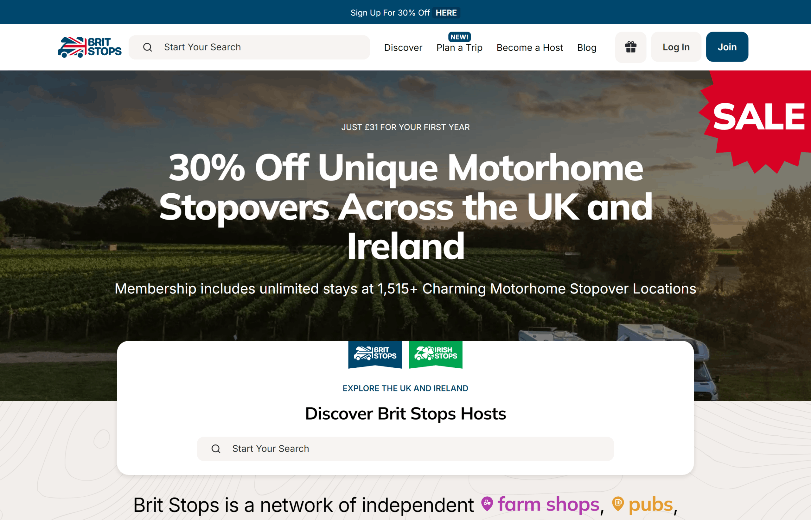
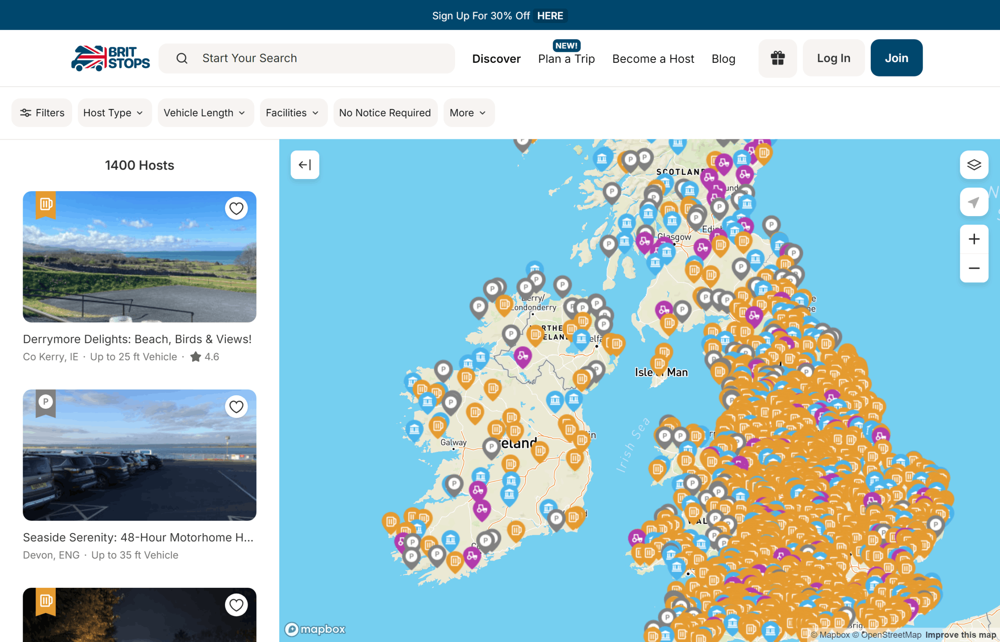
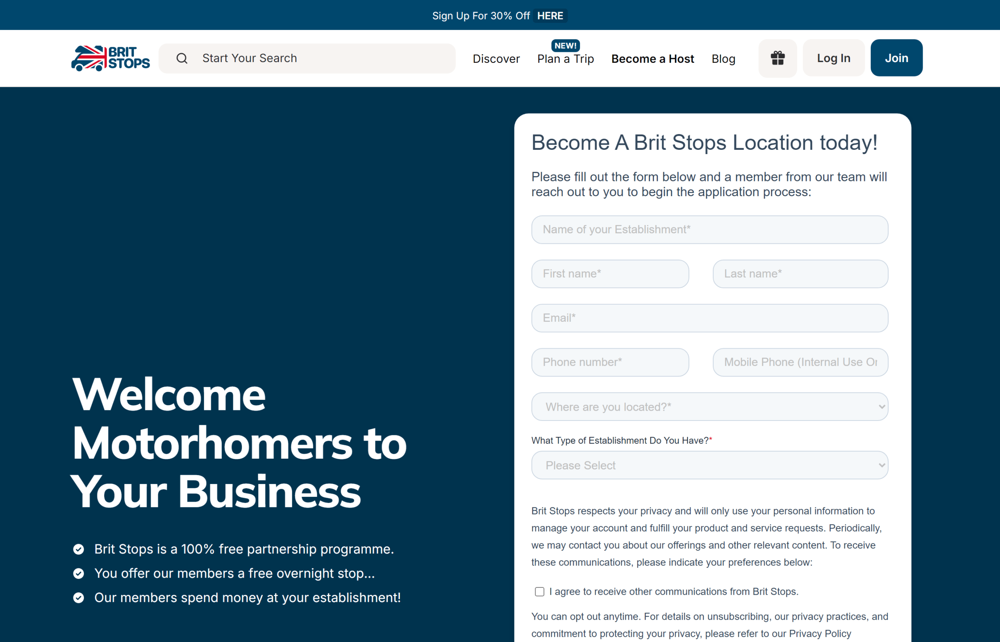
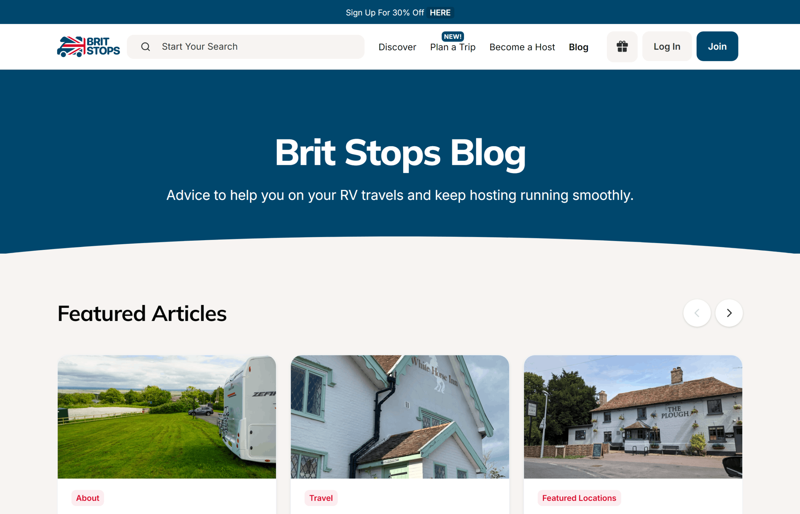

## The Challenge

[Brit Stops](https://www.britstops.com/) represented Harvest Hosts’ expansion beyond its established North American market and into Europe. The product was an annual guide and companion app that connected motorhome and campervan travellers with hundreds of UK host sites – farms, pubs, vineyards and farm shops – offering free overnight stays. It served a pan-European customer base, sold direct and through resellers in Germany, the Netherlands, Spain and Norway, on an annual cycle that refreshed every March.

The storefront ran on an ageing, hand-rolled PHP monolith: procedural page scripts for the shop, basket, checkout and membership join flows, a bespoke class autoloader, almost no dependency tooling, and a Stripe SDK pinned to v7.8.0 with no documentation available. Routine content changes required a developer, the codebase was risky to extend, and the annual product cadence demanded a storefront the marketing team could run without engineering.

As a newly acquired brand entering the portfolio, Brit Stops needed to align with Harvest Hosts’ modern, maintainable technology standards while keeping its distinct brand and its multi-reseller commerce intact.

## The Solution

Quarry replatformed Brit Stops onto a modern headless architecture. We built a new storefront on [Next.js](https://nextjs.org/) with React, TypeScript and Tailwind, using server rendering and static generation for SEO and speed, with a blog, sitemap, and country-based internationalisation for the European audience.

We decoupled content into a headless WordPress CMS using Atlas Content Modeler for structured content types, exposed over [WPGraphQL](https://www.wpgraphql.com/) and consumed through Apollo Client, with Yoast for SEO – including the documented integration patches needed to make Atlas Content Modeler, Yoast and GraphQL cooperate. This handed day-to-day control of listings, pages and blog content to the marketing team.

We modernised payments, moving off the undocumented legacy Stripe v7 integration to a modern [Stripe](https://stripe.com/) Checkout flow that supported one-time book purchases alongside yearly and worldwide subscription tiers.

Finally, we added two lightweight [Cloudflare Workers](https://workers.cloudflare.com/) edge services – member authentication and a configurable promotional offer bar injected at the edge – each deployable independently of the storefront.

   

## The Results

One headless storefront serves Brit Stops direct and through resellers in Germany, the Netherlands, Spain and Norway, from a single codebase. Listings, pages and blog content live with the marketing team in the headless CMS, and the annual March refresh needs no engineer.
