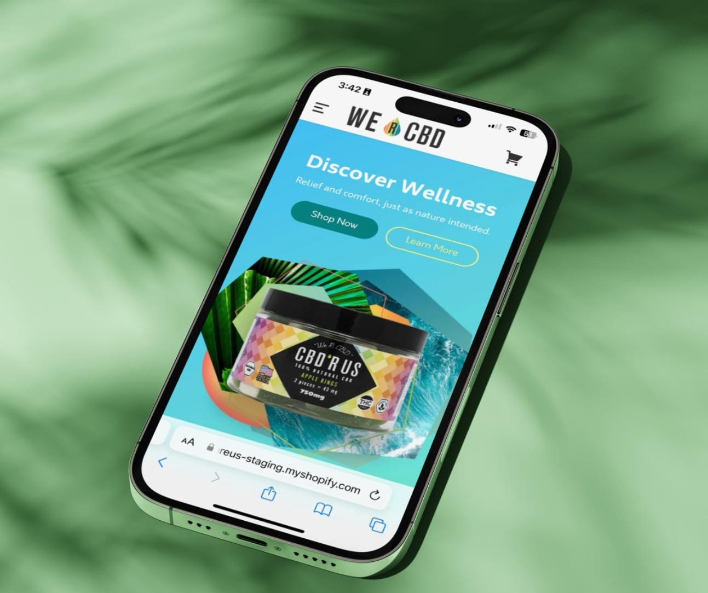
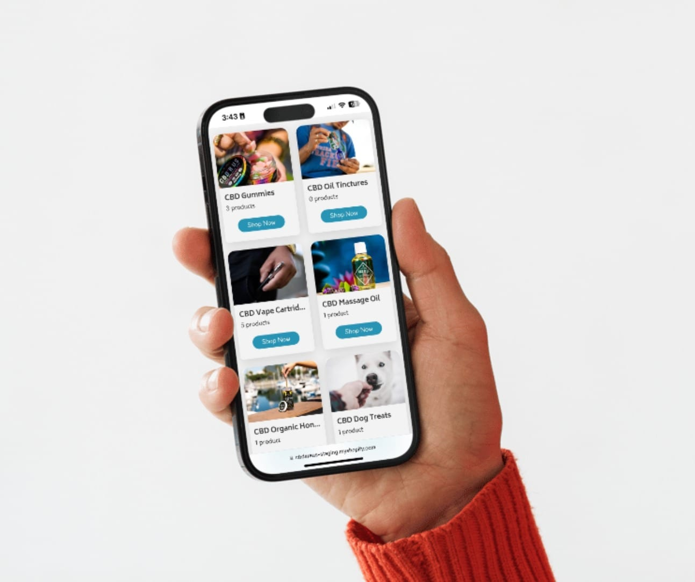
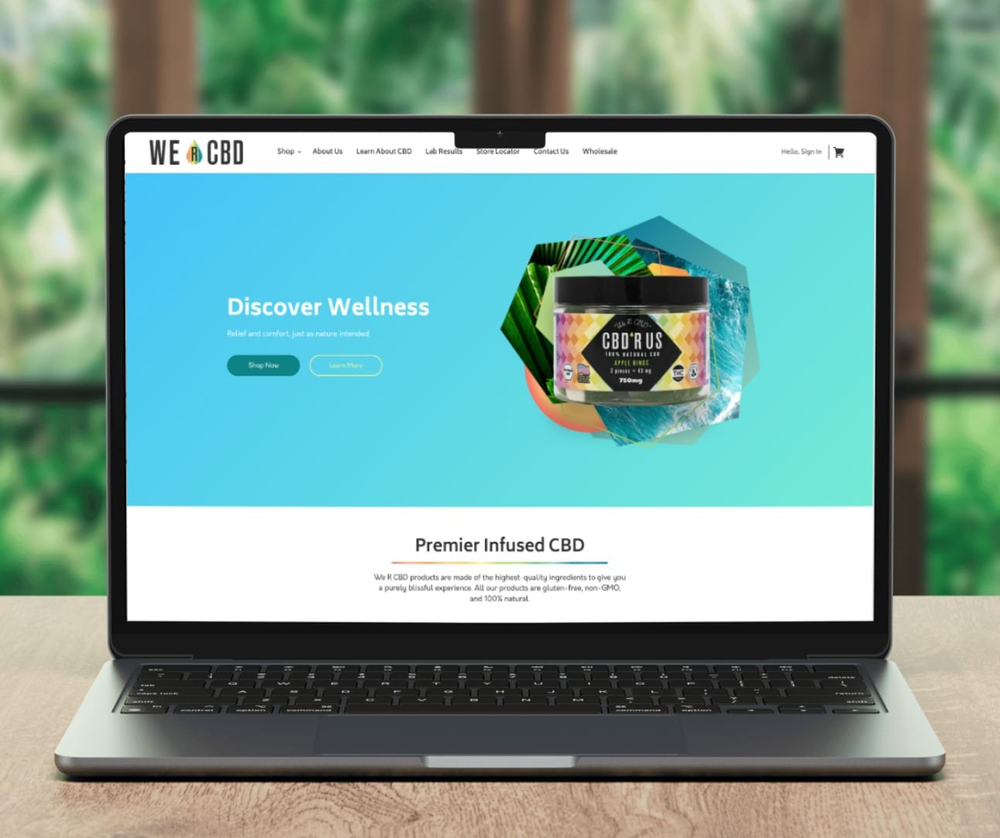
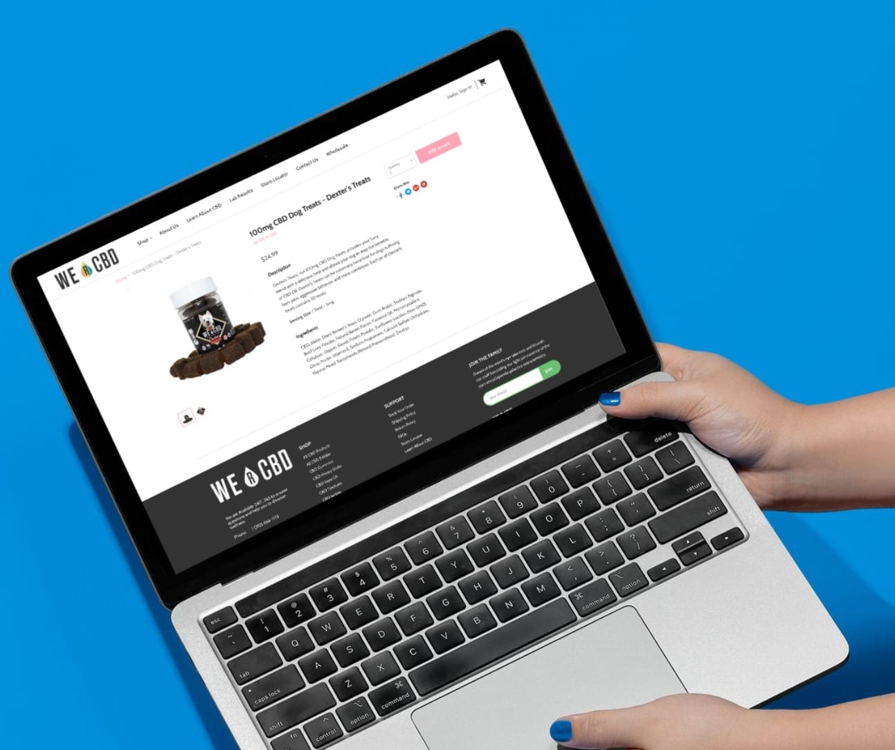
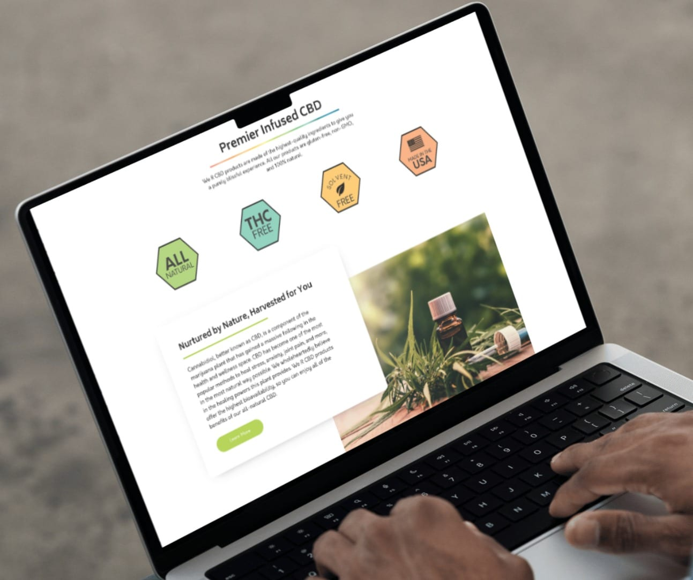

## The Challenge

The CBD retailer’s online storefront hadn’t been updated in years, and the initial design phase had been done back when most layouts were done using Photoshop, making modernization a necessity.

    

## The Solution

Quarry adopted an MVP approach for the required updates, utilizing an existing Shopify theme to ensure cost-efficiency and speed. We focused extensively on customizing global elements like headers, footers, and the homepage.

The site showcased vibrant lifestyle imagery provided by the client, enhancing their already colorful and established brand identity.

The design and development phases were meticulously executed with the goal of significantly improving the user engagement and showcasing the brand’s overall aesthetic appeal.

## The Results

The redesigned Shopify storefront successfully demonstrated a twofold increase in revenue, along with major gains in conversion rates and average order value.

Feedback from the client was that the updated storefront performed exceptionally well, and that Quarry’s re-design efforts boosted revenue and helped sustain the brand’s operations for several years post-project completion.
