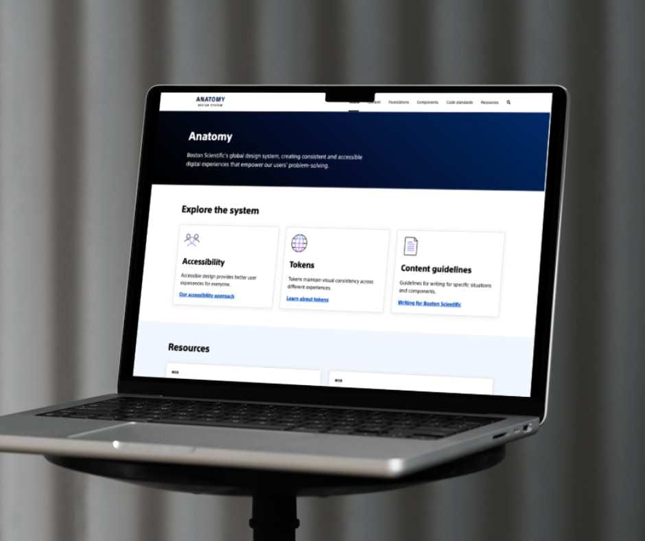

## Modernizing Boston Scientific’s DEI Web Presence

## The Challenge

- Redesign and modernize the Boston Scientific DEI web pages
- Use in-house design system “[Anatomy](https://www.anatomydesignsystem.com/resources/designers/libraries)” to complete the project

Boston Scientific was faced with the challenge of modernizing certain pages on its website, specifically under the Diversity, Equity, and Inclusion (DEI) section.

[These pages](https://www.bostonscientific.com/en-US/careers/working-here/diversity-and-inclusion.html) were outdated, operating under a legacy UI/design system, established before the implementation of any formal design system. The need was to transition these pages to a newer, more modern design system to enhance user experience, coherence, and the overall aesthetic appeal of the website.

The pages in question, including the DEI strategy page and the workforce data page, play an important role in demonstrating Boston Scientific’s dedication to Diversity, Equity, and Inclusion initiatives.

 

## The Results

- Created new designs with [Boston Scientific’s official design system](https://www.anatomydesignsystem.com/resources/designers/libraries), Anatomy, ensuring brand consistency
- Designed engaging infographics, charts, and data visualizations on the workforce data page
- Redesigned pages implemented by Boston Scientific’s in-house engineering team

Quarry took on the project to redesign Boston Scientific’s DEI homepage and other internal pages, incorporating the use of Boston Scientific’s official design system named “Anatomy.” This design system played a pivotal role in the project, especially since it is not common for clients to maintain official design systems so meticulously.

We were able to leverage Anatomy’s sketch package, which acted as the design representation of the design system, maintained alongside the web UI, leading to a seamless design process. The redesign included the DEI strategy page and the workforce data page, which feature new infographics and charts that were both informative and visually appealing, using the Anatomy design system.

These redesigned pages are now live, showcasing the successful migration to the modern design system and the implementation of the new designs by Boston Scientific’s in-house engineering team.

This project not only modernized the DEI section of the website but also highlighted the effectiveness of utilizing a well-maintained design system in creating coherent and impactful and consistent UIX designs that can be shipped to production much more quickly.

 
