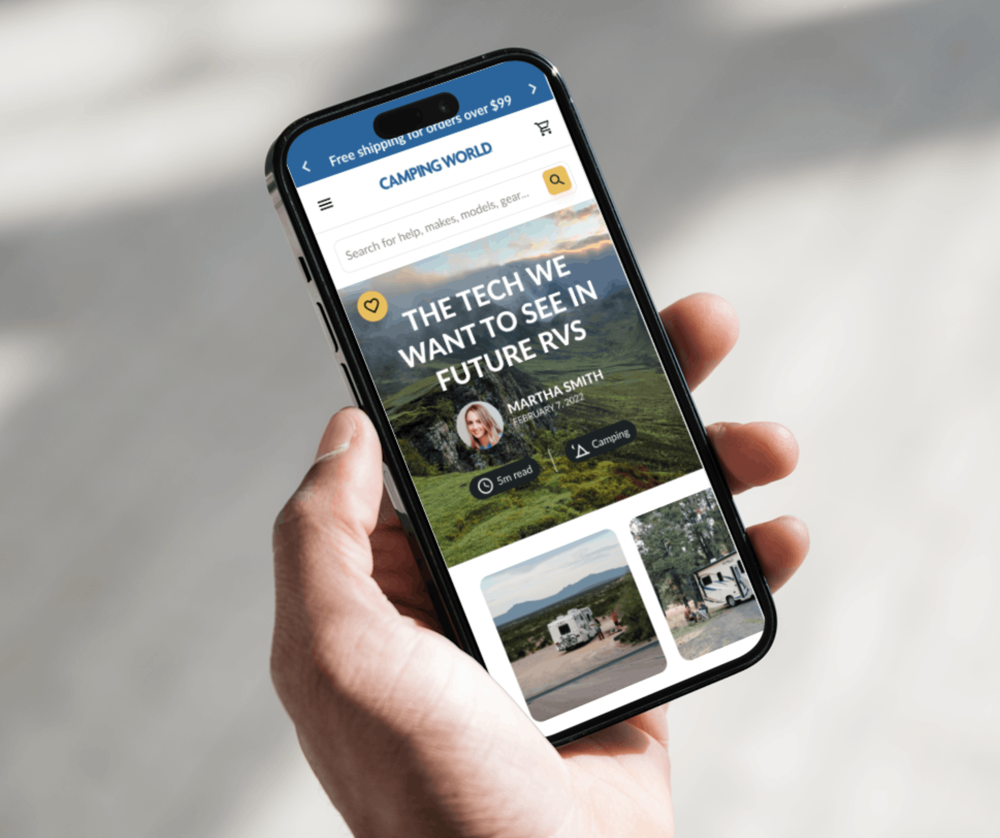
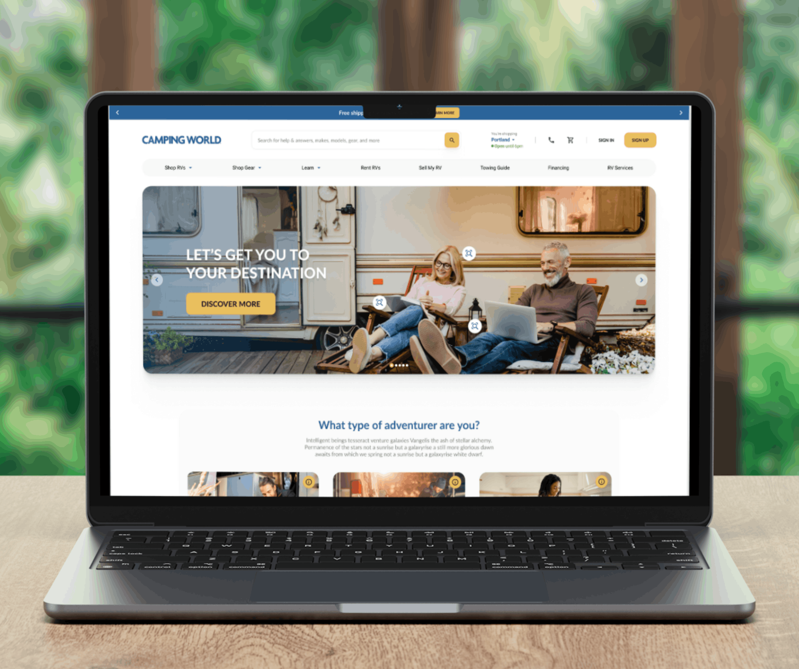
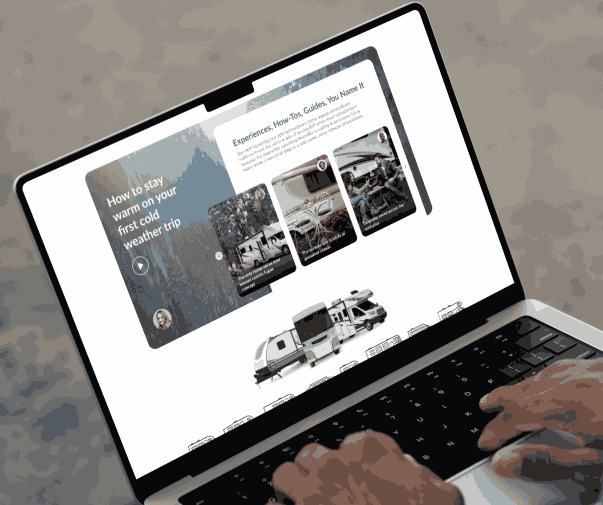
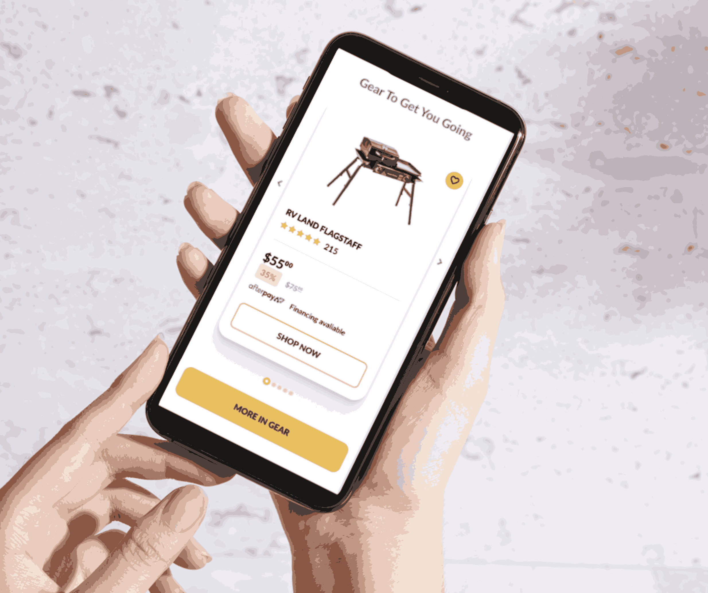
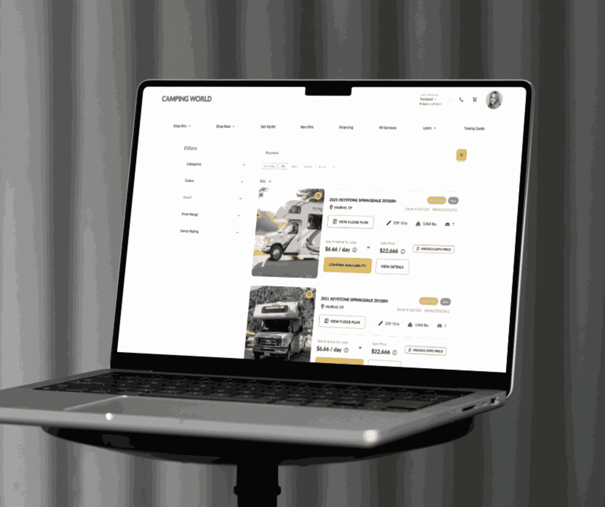

## The Challenge

Camping World’s design team identified the need for an update in their user interface (UI) design across their digital platforms.

They faced a significant challenge with their split web experience: one part of the website was dedicated to RV unit sales (rv.campingworld.com), while the other focused on retail products (campingworld.com).

This separation resulted in a disjointed customer experience and missed opportunities for sales and engagement.

Additionally, Camping World recognized that they served a diverse spectrum of users ranging from RV veterans to newcomers intrigued by van life, which necessitated a more personalized and inclusive web experience.

    

## The Solution

Quarry was one of several firms invited to address these challenges – with the intended outcome of bringing fresh insights to the Camping World team. We thoughtfully redesigned the web experience to unify the RV unit and retail product sales, creating a more cohesive and engaging user journey.

### Implemented Customer Segmentation

The brief highlighted Camping World’s diverse user base, ranging from seasoned RVers (“legacy customers”) familiar with towing and RV maintenance, to “van life curious” younger individuals with no RV experience, attracted to the lifestyle.

Positioned between these two segments are families, often with some amount of RV experience, potentially on their first RV, representing a middle ground in the customer spectrum.

This variety of potential customer base underscores the need for a tailored approach to meet the varied needs and knowledge levels of Camping World’s clientele.

### Customized Content

The new design emphasized content heavily, with a focus on personalization for authenticated users. This meant tailoring content based on the user’s persona, purchase history, and other personal data, aiming for a highly personalized user experience.

The design featured modern, striking content pages with engaging elements like product zoom features and narrative-driven product interaction.

Additionally, a rating system was introduced to guide beginners, alongside interactive videos with embedded product highlights for a more immersive experience. The approach combined modern design with personalized, interactive elements to enhance user engagement and product discovery.

### Search Improvements

Quarry revamped and unified the search experience for RV units, products, and content under [a federated search](https://en.wikipedia.org/wiki/Federated_search). The new design aimed to bring all search results together, allowing users to search for everything simultaneously and intuitively sort and filter the results.

This included categorizing search results to cover a wide array of content, from RV units to stories, articles, and videos related to specific search terms.

The updated design also introduced features to streamline the user’s search experience, including new filters, the ability to focus on specific types of results (e.g., just RVs), and enhanced product presentation with information on pricing, condition, and financing options.

Additional elements like auto-suggest results were included to further refine the search process, making it more efficient and user-friendly.

## The Results

The redesign bridged the RV-unit and retail-product journeys in one design system, tailored to every customer segment from seasoned RVers to the van-life curious.

The design delivered unit-based UX features, personalized content for authenticated users, and an improved federated search with auto-suggest across RV units, products and stories: one integrated, customer-centric journey spanning both storefronts.
