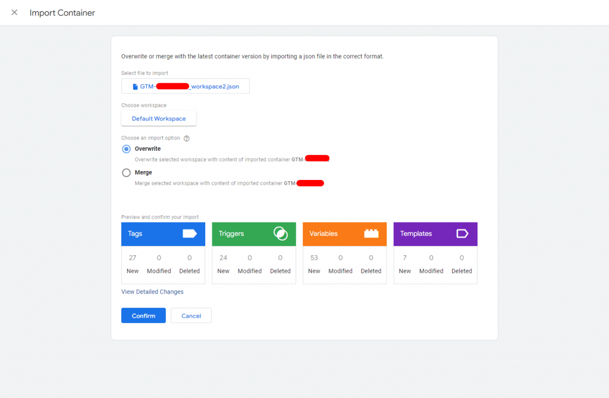

---
# Cited in the /compliance evidence ledger (apps/web/src/lib/compliance.ts) — keep that claim in sync.
title: 'Restructuring data collection makes launch builds 7.5x faster for a global gaming brand'
client: 'Confidential'
summary: 'We restructured a global gaming brand’s data collection — centralized, compliant, and cutting each title’s data-collection launch build from 15 hours to 1–2.'
disciplines: ['design', 'engineering', 'data', 'strategy']
industry: 'Gaming'
outcome:
  kicker: 'Accelerated.'
  headline: 'Data-collection launch builds went from 15 hours to one or two, standardized across every title.'
  stat: { value: '7.5×', label: 'faster data-collection builds' }
releasedDate: 2024-02-05
hero: ./hero.jpg
heroAlt: 'Abstract web of black nodes connected by thin crisscrossing lines on a white background, resembling a network graph'
featured: false
order: 15
heroCredit: 'Photo by [Alina Grubnyak](https://unsplash.com/@alinnnaaaa?utm_content=creditCopyText&utm_medium=referral&utm_source=unsplash) on [Unsplash](https://unsplash.com/photos/low-angle-photography-of-metal-structure-ZiQkhI7417A?utm_content=creditCopyText&utm_medium=referral&utm_source=unsplash)'
---

## How innovative data collection transformed a major video game company’s approach to marketing efficiency and compliance

Photo by [Vincentiu Solomon](https://unsplash.com/@vincentiu?utm_content=creditCopyText&utm_medium=referral&utm_source=unsplash) on [Unsplash](https://unsplash.com/photos/a-black-and-white-photo-with-a-red-spot-in-the-center-N2zxMUDwT4I?utm_content=creditCopyText&utm_medium=referral&utm_source=unsplash)

## The Challenge

- Diverse data collection challenges
- Lack of centralized coordination
- Marketing reporting difficulties and data loss issues

A well-known video game company faced challenges with its data collection with many different standalone marketing sites for individual AAA titles.

Historically, different teams worldwide had a variety of data requirements and systems in play, leading to disjointed and inconsistent data gathering, with no uniformity in requirements or reporting throughout the company.

The absence of a centralized data collection team resulted in outdated practices and data inconsistencies, including significant gaps in data spanning months or years.

The lack of standardized data made it difficult for individual teams to report on marketing campaigns, efforts, or key performance indicators (KPIs).

Additionally, blind spots and oversights were common, leading to data loss because data collection was not implemented effectively from the start of the project.

## The Solution

- Innovative data collection template development
- Global standardization and effortless updates
- Comprehensive data strategy and custom reporting

Quarry modeled a data collection template on one of the global brand’s most successful franchises, the title with the most mature data collection infrastructure. Basing the data collection templates off of this title allowed Quarry to produce a blue sky boilerplate for data collection that ensures maximal and consistent data for all new titles from day one.

Quarry developed a boilerplate container for Google Tag Manager, incorporating every tag and piece of infrastructure, along with additional best practices.

This container could then be used for every product marketing site upon its launch and – most importantly – retroactively applied to existing sites. This approach expedited the process of data collection for market entry, ensuring standardization of data across all properties.

This container can be thought of as a sort of “Git repository” that acts as a monorepo for the organization’s data collection instrumentation across all product marketing sites. Whenever a change or update was needed (i.e. a team in Europe requiring a new vendor tag), Quarry would add the new tag to this existing boilerplate and distribute it across all marketing sites. This ensured uniform updates with minimal effort, providing a global solution rather than isolated site-specific adjustments.

Quarry replicated this approach for server-side Google Tag Manager, which the organization hadn’t adopted before, and Quarry recommended its implementation as a best practice. Developing a similar boilerplate for server-side Google Tag Manager, produced the same benefits as its client-side counterpart.

Emphasizing a “maximal collection” approach to ensure data availability for any of marketing’s future requirements, we aimed to gather as much data as possible from each marketing site.

Quarry also overhauled the data schema in these containers for better organization, tidiness, and standardization. This made maintenance easier over time and ensured consistent data collection across all containers.

With a global data schema in place, Quarry created runbooks outlining specific best practices for data collection implementation across the organization.

Additionally, Quarry developed a Standard Operating Procedure (SOP) for integrating data collection into the software development lifecycle. This SOP aimed to eliminate blind spots and oversights by incorporating data collection planning early in the development process.

Another key aspect of this project was creating custom reports for various teams to monitor their specific KPIs, marketing efficiencies, and campaign performances. These reports combined custom GA4 and Looker Studio reports. Given GA4’s limitations for non-technical team members, we often exported data to Looker Studio for a better user experience and easier report adjustments by clients and contributors.

The import of the client-side Google Tag Manager container that was developed.

## The Results

- Streamlined data collection process
- Uniform data standardization and improved measurement
- Enhanced data privacy compliance

This new approach to data collection significantly reduces the costs of engineering and maintenance, particularly over time.

There’s an 86% reduction in time spent on initial build and launch—what previously took 15 hours now takes just 1-2 hours with the new boilerplate process, now streamlined to a few simple steps. Importing with a few clicks, setting vendor-specific keys in the container, and then deploying it.

This process, akin to infrastructure-as-code in engineering or DevOps, stands in stark contrast to the previous method where each vendor, tag, and variable was manually set up.

Data is now uniformly standardized across the organization’s entire product portfolio. While the business value of this standardization is hard to quantify, it offers significant benefits. It enables consistent measurement across different product marketing sites, facilitating direct comparisons and combined data analysis for effective A/B testing or apples-to-apples comparisons.

Measurement efficiency is dramatically improved, benefiting from standardized data and streamlined processes.

There’s also a significant benefit to data privacy compliance, a crucial factor for a global organization.

Previously, compliance was managed manually, increasing the risk of human error. The new automated data collection instrumentation pipeline ensures compliance from the start, reducing the risk of fines under regimes like the EU’s GDPR for data privacy violations. Building the requirements into the boilerplate is privacy information management in the sense ISO/IEC 27701 formalizes: every site launches with compliant collection by default, instead of each team rediscovering the rules by hand. Data privacy is thoroughly integrated, offering significant risk management and predictability in data results moving forward.
