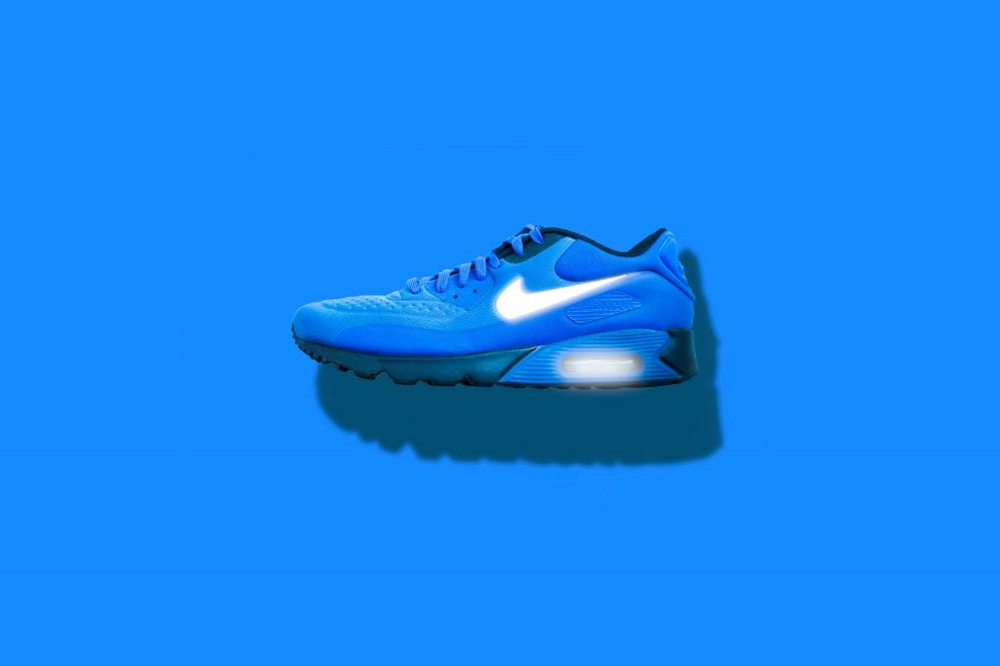

With this post, we’ll uncover some of the details of brand experience.

_This post is number three in our series “Building a Brand” for part 1 see **[What is a Brand?](/blog/what-is-a-brand-building-a-brand-part-1)** For part 2 see **[Visual Identity](/blog/building-brand-2-how-to-improve-visual-identity).**_

## What is brand experience?

Brand experience is the impression that your brand leaves with customers. It is the memories that the brand creates in the mind of customers. It is the way that your brand makes customers feel, both about the brand, and themselves.

Does your brand make customers feel happy, important, successful, powerful, loved? These are all pretty ideal emotions to convey to customers. However, keep in mind that brand experience can evoke both positive and negative emotions.

Every customer interaction is charged with emotion. This is the nature of all human relationships, and relationships between brands and their customers are no different. It is the responsibility of all brands to ensure that the experiences they are creating for their customers are at the very least, positive in nature.

## What are customer interactions?

Since brand experience is created through interaction, let’s define the two types of interactions that customers will have with your brand.

Photo by [Crew](https://unsplash.com/photos/szCvt1gP2d4?utm_source=unsplash&utm_medium=referral&utm_content=creditCopyText) on [Unsplash](https://unsplash.com/search/photos/customer?utm_source=unsplash&utm_medium=referral&utm_content=creditCopyText)

### Passive

Passive interactions are those which are non-conversational. This would include the copy on your website, your sales materials, your help center, etc. Your phone system is a passive interaction. Passive interactions would also be the conversation surrounding your brand, in which the brand is not directly involved, or in other words, conversations taking place about your brand.

### Active

Active interactions are those in which your brand is outwardly initiating or participating. Some examples of this would be email campaigns, press releases, customer service calls, live chats, all forms of advertising, social media interactions, and more. Active interactions can be described as everything that your brand initiates with the outside world.

## Designing your brand experience

Brand experience happens passively. Your brand is providing an experience to your customers every day, with every interaction, whether you are aware of that fact or not. Once you comprehend the existence of your brand experience, you can then begin to craft it with intention.

The key to designing an extraordinary and memorable experience for your customers is _**intention**_. To begin taking control and intentionally crafting the experience your brand is presenting to your customers right now, all that you need is to begin exercising intention in every outward-facing area of your business.

Photo by [Daria Nepriakhina](https://unsplash.com/photos/zoCDWPuiRuA?utm_source=unsplash&utm_medium=referral&utm_content=creditCopyText) on [Unsplash](https://unsplash.com/search/photos/study?utm_source=unsplash&utm_medium=referral&utm_content=creditCopyText)

Take a moment to consider what kind of an experience your brand could be providing to your customers right now. Would it be professional? Would your brand make your customers feel special or important? Could your brand experience be frustrating or disappointing in any way?

Once you have an idea of where your brand experience is now, next decide on what your ideal brand experience would be. This should be summarized in two to three sentences.

With this goal in hand, you can begin to analyze where your brand may be falling short or failing to provide your ideal experience. After you have recognized these shortcomings, you can then assess what needs to change in order to reach your goal.

## How to apply intention

What does it look like to exercise intention in your business? Quite simply, it is a mindset. It is deliberately considering the feeling that will be evoked by every outward-facing facet of your business.

To get more tactical, below are some specific examples.

### The quality of your product or service

This is an obvious, but incredibly important item. Quality is pretty straightforward. If your product or service is of high quality, your customer’s experience of and with it will be high-quality. If your product or service is of low quality, your customer’s experience will be low-quality.

Photo by [Alexander Rotker](https://unsplash.com/photos/l8p1aWZqHvE?utm_source=unsplash&utm_medium=referral&utm_content=creditCopyText) on [Unsplash](https://unsplash.com/search/photos/product?utm_source=unsplash&utm_medium=referral&utm_content=creditCopyText)

### The packaging of your product, or the delivery of your service

Packing and delivery both go an incredibly long way towards influencing brand experience. Successful brands are very aware of this and pay close attention to detail in their product packaging, or service delivery.

Consider Apple, for an example of product packaging. If you have ever purchased an Apple product before, then you will be familiar with the quality of their packaging. Their packaging is sleek and well designed, creating a high-end feeling. As mentioned, Apple pays painstaking attention to detail when it comes to their packaging. Even the materials, like the cardboard used, are of very high quality. Apple’s packaging immediately conveys quality before you even touch the product itself.

Photo by [Charles Deluvio](https://unsplash.com/photos/QodV5ti37WA?utm_source=unsplash&utm_medium=referral&utm_content=creditCopyText) on [Unsplash](https://unsplash.com/search/photos/packaging?utm_source=unsplash&utm_medium=referral&utm_content=creditCopyText)

### Your return or refund policy

The way in which your brand approaches returns is another obvious area of brand experience. Returns are an area of the brand experience that is more emotionally-charged than others and can also be very polarized. Every return or refund request is an opportunity to either delight or disappoint a customer. There is very little middle ground in returns or refunds.

Customers are disappointed when they are expecting or hoping to be able to return an item or receive a refund only to find out that they cannot. However, customers can be delighted when a return or refund exceeds their expectations.

Successful brands understand this and leverage the return experience to delight their customers.

Photo by [Lesly Juarez](https://unsplash.com/photos/1AhGNGKuhR0?utm_source=unsplash&utm_medium=referral&utm_content=creditCopyText) on [Unsplash](https://unsplash.com/search/photos/happy?utm_source=unsplash&utm_medium=referral&utm_content=creditCopyText)

### The way your customer service team greets customers

This is another simple one, and it does not cost your business a cent. When a customer reaches out to your brand for service or support, how are they greeted? If over the phone, is it a friendly, welcoming voice, or a bored and bothered one? If over email, social media, or chat, does the customer receive a warm personal response, or a generic, canned message?

### How easily customers can reach you by phone

Another simple one, yet one at which so many small businesses fail.
The scenario: a customer is trying to ring you to get a quick question answered, or needs an immediate response for an important issue. They may even be calling to order your product or service, but instead, they get a voicemail. How do you think this makes them feel? You’ve probably had this experience yourself more than once. It’s frustrating and annoying. If you’re a business that needs to accept phone calls for any reason, make sure that your customers can always reach you by phone during business hours.

Photo by [Søren Astrup Jørgensen](https://unsplash.com/photos/h8mXDW2XniI?utm_source=unsplash&utm_medium=referral&utm_content=creditCopyText) on [Unsplash](https://unsplash.com/search/photos/phone-call?utm_source=unsplash&utm_medium=referral&utm_content=creditCopyText)

This is a very broad sample of items and events which contribute to brand experience. This list is by no means exclusive, of course. There are far more items which contribute to the overall brand experience. This list is merely meant to provide some tangible examples and point you in the right direction so that you can begin analyzing your own brand experience.

## Summing it up

Brand experience is critical to distinguish yourself from the competition. It permeates every outward-facing facet of your business.

It is easy to ignore and overlook brand experience, but regardless, it is still in play. To take control of your brand experience, you must adopt a mindset of consciousness and intention.

A well-crafted and memorable brand experience can create a significant, competitive advantage in the market and contribute to tangible business growth.
