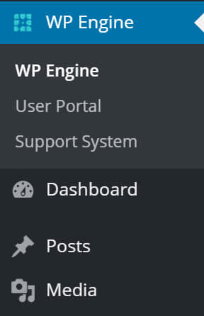
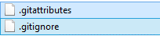
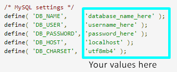
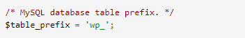
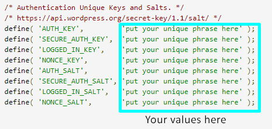

We recently redesigned a WordPress site for a client who was migrating away from WP Engine. When we migrated the client to the new host, they still had a “WP Engine” section in their WordPress dashboard main menu.



Since this feature set would no longer be utilized, it was best to get the plugins removed to keep things lean and tidy.

While cleaning up those WPE remnants, we put together a short guide on how to remove these plugins on your own. Hope it helps!

## 1\. First things first, backup

In order to remove these WP Engine plugins and remnants, we’ll be making some changes to the file structure, and modifying a core WordPress file. That means you should create a full backup of your WordPress environment in the event that something goes wrong. Broken sites and lost data make for a bad day, so backup to stay safe!

## 2\. Delete WP Engine Plugin Folders and Files

Once your backup is safely made, connect to your WordPress environment via FTP, or via your cPanel’s file manager. Locate the “wp-content” folder in your base WordPress directory, then delete the following files and folders.

- wp-content/mu-plugins/mu-plugin.php
- wp-content/mu-plugins/wpengine-common/
- wp-content/mu-plugins/slt-force-strong-passwords.php
- wp-content/mu-plugins/force-strong-passwords/
- wp-content/mu-plugins/stop-long-comments.php
- wp-content/advanced-cache.php
- wp-content/object-cache.php
- wp-content/mysql.sql

Once you have deleted all of these files and folders, if the “mu-plugins” folder is now empty, you can go ahead and delete it too.

## 3\. Delete WP Engine git files from the root

Next, head back to your WordPress root directory, and look for and delete these two files.

- .gitattributes
- .gitignore



## 4\. Generate a fresh wp-config.php file for your installation

WP Engine modifies your site’s wp-config.php file. Now that you have removed all of their leftover elements from your installation, you will also want to make sure that your site is running on a clean wp-config file.

Firstly, locate and open the wp-config.php file in the root of your WordPress environment.

Now head to GenerateWP to grab a [clean code set for the wp-config file](https://generatewp.com/wp-config/). Copy the code from GenerateWP and paste it into a new file in your text editor.

Now jump back to your current wp-config file which you opened a moment ago. You will want to copy the values for all of these fields and paste them into the new wp-config file that you just created.

### Database credentials

```php
define( 'DB_NAME',
define( 'DB_USER',
define( 'DB_PASSWORD',
define( 'DB_HOST',
define( 'DB_CHARSET',
```



### If your table prefix begins with anything other than “wp\_” (uncommon)

Be sure to update your table prefix if it begins with anything other than “wp\_”.

```php
$table_prefix =
```



### WordPress Secret Keys & Salts

```php
define( 'AUTH_KEY',
define( 'SECURE_AUTH_KEY',
define( 'LOGGED_IN_KEY',
define( 'NONCE_KEY',
define( 'AUTH_SALT',
define( 'SECURE_AUTH_SALT',
define( 'LOGGED_IN_SALT',
define( 'NONCE_SALT',
```



After entering all of your database values, keys, and salts, save the new file as wp-config.php, then upload it to the root of your WordPress installation, overwriting the existing file.

Once that is complete, log into your WordPress admin panel and you should now be free of all WP Engine menus and plugins.
