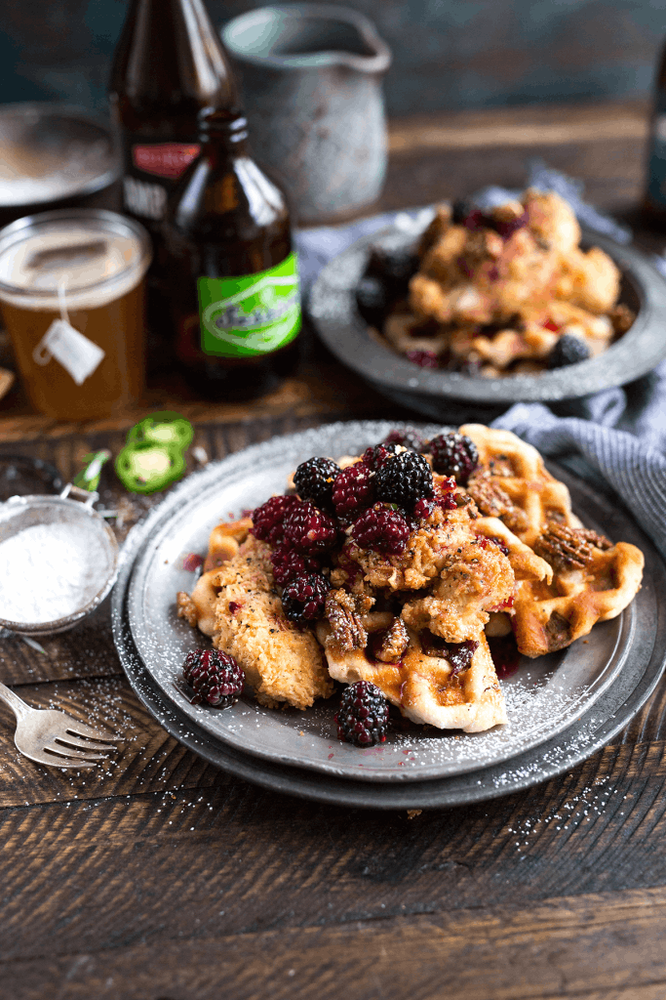

In this post, we’ll explore an important topic regarding restaurant website design and user experience: **consumers search for restaurants when they are hungry.**

## “Hungry” user behavior

This means that consumers (or potential patrons of your establishment) are making their dining decisions on an empty stomach.

Consider the following statistics:

> 85 percent of hungry mobile users searching for food go on to complete a purchase
> [xAd](http://www.groundtruth.com/) Study

> Restaurants are the most searched industry by consumers on mobile devices
> [Chadwick Martin Bailey](http://www.cmbinfo.com/) Study

Naturally, you want these hungry consumers to choose your establishment when making their dining decision. However, as you know, there is a lot of information that these consumers will be parsing while making their decision. (cuisine type, proximity/location, price, reviews, hours, etc) Not to mention the fact that there is a significant amount of competition that will be vying for the consumer’s business.

How can you distinguish yourself from the competition and create an advantage when attempting to win the consumers’ dining decision?
Capitalize on the consumers’ hunger by prominently showcasing large, professional photos of your most popular dishes in order to prompt an impulse decision.

Is that waffle making you hungry? No? Well, you get the point…

Such “food porn” shots of your establishment’s fare can often have a significant influence on your potential patron’s dining choices by triggering an immediate impulse decision as a response to the food imagery presented to them.

This can occur either consciously or subconsciously.
Sometimes this can be as direct as seeing the right shot of a plate of nachos, or a gourmet salad which prompts the consumer to consciously decide “I want to go there, and eat that.”

> _Restaurants are the most searched industry by consumers on mobile devices._

In other cases, the effect is more subconscious and the consumer may not be aware that the images of delicious looking dishes are significantly impacting their decision making.

Either way, the result is the same.

This type of impulsive decision is a huge win for you and your restaurant in that it instantaneously rules out any other options for the consumers dining destination.
**Then and there, you have won the business.**

## Tailor your user experience

As mentioned, the homepage is an ideal location for placements of your tantalizing “food porn” imagery. Further still, as close to the top of the page as possible, maybe in a slider or hero section.

That being said, your website represents your restaurant, and more specifically your food, therefore it is certainly appropriate to include imagery of your fare throughout your website.

**Bonus points:** if you want to get even more mileage out of this technique, consider placing food imagery prominently alongside important call-to-actions on your site. (Reservation forms, phone numbers, etc)

## Apply this

Follow the steps outlined below to put this restaurant marketing tip to work on your establishment’s website today!

1.  **Produce high quality, professional level photos of your best-selling dishes** (for inspiration, study the food photography on the sites below)
2.  **Feature these images in prominent, key locations on your establishment’s website** (homepage, alongside call-to-actions)

Have a look at the websites below for examples of restaurants that are putting this technique to work.

- [Boqueria](https://www.boqueriarestaurant.com/)
- [Raclette – New York – The original raclette specialty restaurant](https://raclette.nyc/)
- [Vernick Food & Drink | Philadelphia, PA](https://www.vernickphilly.com/)

We hope that this post has been valuable and practical for you. Now, if you’ll excuse us, we’re off to find some waffles…
