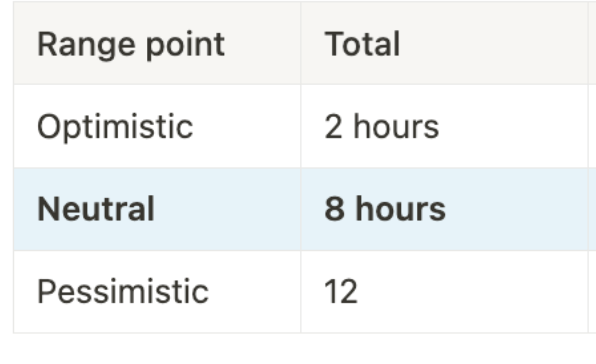

Recently, a Quarry staffer was waffling over whether to reduce the number of hours we estimated a portion of a new project would take.

They were worried the number looked too big, even though it was an honest and accurate assessment of how long it would take to do their portion of the project.

I told them that estimation should equal as precise of a measurement as possible — what will it actually take to produce something? Whether there is a business case or an adequate cost/benefit ratio is up to the business stakeholders to decide.

With years of experience in project management and client relations within the tech industry, and after nearly a decade of owning a web software firm, I’ve seen firsthand the repercussions of inaccurate project estimates. Wasted time, wasted money.

My role has always involved ensuring that projects are scoped realistically and delivered successfully, which has given me deep insights into the importance of honest estimations.

## How does Quarry handle estimates?

We employ ranges in all of our estimates at Quarry – pessimistic, neutral and optimistic. Each row includes an hours and a cost estimate.

Why? Because our client’s capital planning is very sacred to us at Quarry. We want to ensure that our clients are empowered to make the most informed capital planning and budget decisions possible, with zero risk of overages or surprise costs.

(The majority of our projects end up under the neutral mid-point. For a project to reach the full pessimistic end of the range is both unlikely and unheard of.)

**Ranges allow for important and realistic flexibility in the lifecycle of the project.**

That might look like shifts in requirements, new requirements along the way, unexpected additional effort requirements, etc. Including this information up front helps mitigate the need for change orders and prevents frustration.

## But Wait, What’s the Problem with an Inaccurate Estimate?

When businesses seek out tech vendors, one of the biggest pieces of information needed to greenlight a project is the estimate provided.

Most issues that pop up are a result of some discrepancy between the estimate and actual project timelines and costs. This leads to budget overruns, missed deadlines, and strained vendor-client relationships.

While businesses may publicly discuss their frustration with delayed projects, privately, they might struggle with internal accountability and the pressure of justifying these delays and additional costs.

But, what’s the root cause of these inaccurate estimates? Many vendors tend to underscope projects, either due to inexperience or a desire to win the contract at all costs.

They present wildly optimistic timelines and slash costs to appear more competitive, knowing that they’ll extend and expand the project once the company is sunk too deep to pull out and find another vendor.

Businesses often fail to recognize the long-term damage caused by such practices – not just in financial terms but also in terms of lost opportunities, diminished trust, and the stress of managing unexpected crises.

The cheapest vendor can often end up being the most expensive in the long run – whether that’s added costs over time, or having to end the project and return to a more reputable vendor.

## Real World Consequences

Quarry scoped out a project for a new client who balked at the initial pricetag for a complicated software development project. We explained the reasoning why, and offered up our estimate for them to take elsewhere.

About a year went by before we heard from them again. They approached us for a different project, and we asked what had happened with the previous project.

They’d gone with another vendor, who had grossly underestimated the entire project – promising lower costs and an unrealistic timeline of three months.

Impressed by the competitive pricing and timeline, the company decided to proceed. The project began smoothly, but midway through the project, it became clear that the initial estimate was far too optimistic.

The vendor struggled to keep up and the project timeline extended month after month, and costs ballooned out of control. In the end, although the project was eventually completed, the overall experience was a negative one that had damaged our client’s competitive edge in the market.

The company returned to Quarry for their next massive development project, and cited our insistence on accurate estimates as a major reason.

## The 5 Things to Look for in an Accurate Estimate

As a business owner, you should look for vendors who practice transparent communication and realistic scoping. But what does that look like in action? Here are the key things to look out for:

**Detailed Scoping**: Ensure the project is scoped in detail from the outset. This includes identifying all potential challenges and factoring them into the estimate. While there will always be changes to the plan, a detailed scope reduces the likelihood of unforeseen issues that can derail the project.

**Expert Consultation:** Engage experts to review the project plan and provide input on the feasibility of the estimates. External perspectives can provide a more rounded view and identify blind spots the vendor might miss. At Quarry, we have many different internal experts put eyes on all estimates, ensuring that our internal diversity of experience plays a hefty role in bringing the right information to our clients.

**Historical Data Analysis:** Use data from previous projects to inform estimates. Vendors who analyze past projects for insights tend to provide more accurate estimates, as they can anticipate similar challenges and timeframes.

**Buffer for Contingencies:** Always look for the buffer for unexpected issues. This ensures that even if problems arise, the project can still stay on track without significant deviations in timeline or cost.

**Regular Updates and Re-evaluation:** Maintain regular communication with the vendor and re-evaluate the project progress periodically. This helps in identifying any deviations early and allows for course correction before issues escalate.

## What are the benefits of proper estimates and planning?

As we mentioned before, the more information our clients have – the better for planning and understanding the real scope of a project.

Accurate estimates, with ranges, can:

- Create a more predictable project timeline and budget, which aids in better capital planning and resource allocation.

- Build a significant amount of trust between the business and the vendor, and that looks like a stronger working relationship and smoother project execution.

- Curtail the stress and reputational damage that comes with project overruns.

- Set realistic expectations, leading to higher satisfaction among stakeholders and clients.

Ultimately, good estimates are just good business. It means the vendor can deliver the project successfully and the business is seen as a reliable and competent player in the market.

By demanding transparency and thorough planning from vendors, businesses can safeguard their interests and ensure that projects are delivered on time and within budget. This proactive approach is essential for mitigating risks and delivering long-term success and growth.

## Ready for an accurate estimate?

Quarry would be happy to give you a full estimate on your next project. [Book a call](/contact) to discover how our tailored solutions can meet your organization’s specific needs and goals.

_Disclaimer: We love efficiency and we also believe in transparency. LLMs (Large Language Models) were used to structure the outline to save time while writing this piece._
